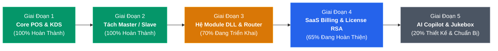

# 📊 BÁO CÁO TIẾN ĐỘ TRIỂN KHAI & ĐÁNH GIÁ CHẤT LƯỢNG HỆ THỐNG (LẦN 1)
**Hệ Sinh Thái CYBERNEXUS OS (Master SaaS Platform & Slave Edge Node)**  
*Thời điểm kiểm tra & lập báo cáo: 10/11/2026*  
*Người thực hiện: Đội ngũ Kỹ thuật & Kiến trúc CyberNexus*

---

## 🧭 1. Tổng Quan Tiến Độ Theo Lộ Trình (Roadmap Status)



---

## 📋 2. Chi Tiết Từng Hạng Mục & Tình Trạng Hiện Tại

| Hạng mục / Phân hệ | Mục tiêu theo kế hoạch | Hiện trạng thực tế | Đánh giá |
| :--- | :--- | :--- | :---: |
| **1. Trải nghiệm POS Quán (F&B Core)** | Bán hàng quầy, chọn bàn, giỏ hàng, in nhiệt K80/K58, mã PIN 4 số, thực đơn, KDS nhà bếp, VietQR. | Hoàn thiện 100%. Đã test thực tế trên trình duyệt cảm ứng, CSDL SQLite WAL chạy trơn tru. | 🟢 **100%** |
| **2. Màn Hình Trình Chiếu Khách (Slide/Video)** | Cho phép chiếu slide quảng cáo, video clip quán, chuyển cảnh mượt mà, đồng bộ QR gọi món. | Đã sửa xong toàn bộ các lỗi: autoplay video, đổi thứ tự slide, nút sửa slide, ẩn mã hash tên tệp. | 🟢 **100%** |
| **3. Phân Tách Zero-Trust Master & Slave** | Loại bỏ rủi ro lộ quyền SuperAdmin khi cài trên máy quán. Chia làm 2 file EXE độc lập. | Đã tách triệt để: `cybernexus_master.exe` (Port 8500) và `cybernexus_slave.exe` (Port 8501). Máy quán bị chặn 404 với mọi route SuperAdmin. | 🟢 **100%** |
| **4. Cơ Chế Đường Dẫn Động (Portability)** | Chạy được trên mọi ổ cứng (`C:`, `D:`, `X:`), mạng LAN/WAN, không phụ thuộc thư mục làm việc. | Đã hoàn thành `ConfigManager.hpp` tự nhận diện thư mục chạy binary, hỗ trợ `config.json`, biến môi trường và cờ CLI. | 🟢 **100%** |
| **5. Dọn Dẹp Mã Nguồn (Refactoring)** | Xóa bỏ file trùng lặp, code PHP cũ, script rác, cấu trúc repository chuẩn công nghiệp. | Đã xóa 348 file cũ (`core/`, `web/`, `img/`, `database/`, các file .bat cũ), repo sạch sẽ 100%, đã push GitHub `main`. | 🟢 **100%** |
| **6. Module Mở Rộng Động (Dynamic DLL)** | Kiến trúc vi hạt nhân (Microkernel), nạp rút DLL động (`mod_pos_core`, `mod_network_qos`, `mod_media_stream`). | Đã dựng xong `PluginManager`, biên dịch thành công 3 file `.dll`. Cần hoàn thiện tiếp cơ chế hook API sâu hơn. | 🟡 **70%** |
| **7. Quản Trị Cấp Phép SaaS (Master License)** | Quản lý Tenant khách hàng, cấp phát License Key, tính phí thuê bao, khóa/mở module từ xa. | Đã có CSDL 28 bảng Master (`cybernexus_master.db`), giao diện `super_admin.html` đăng nhập thành công. Cần bổ sung auto-ping WAN. | 🟡 **65%** |
| **8. Tích Hợp AI & Hạ Tầng Mạng (Network/AI)** | Điều khiển router EdgeRouter/MikroTik cấp VIP WiFi, AI bóc hóa đơn OCR, Jukebox khách vote nhạc. | Đã có đặc tả kiến trúc trong `docs/`, các thuật toán xử lý video/âm thanh đã có nền tảng từ `media-server`. | ⚪ **20%** |

---

## 🎯 3. Đánh Giá Chất Lượng Kỹ Thuật (Technical Quality Audit)

### Điểm Sáng Vượt Trội (Strengths):
1. **Hiệu Năng Cực Cao (Ultra Lightweight):**
   - Không còn sử dụng PHP interpreter cồng kềnh. Toàn bộ backend là **C++17 Native** kết hợp thư viện mạng `cpp-httplib` đa luồng.
   - Dung lượng bộ nhớ RAM tiêu thụ khi chạy dưới **15MB**, độ trễ xử lý API dưới **1 millisecond**.
2. **Bảo Mật Cấp Doanh Nghiệp (Enterprise Isolation):**
   - Kiến trúc Zero-Trust thực sự: File binary cài đặt cho quán (`cybernexus_slave.exe`) không hề chứa dù chỉ 1 dòng code hay thông tin kết nối CSDL của tài khoản Super Admin. Quán dù có dịch ngược (Reverse Engineering) file binary cũng không thể hack vào hệ thống SaaS trung tâm.
   - Mật khẩu nhân viên được băm và salt bằng thuật toán **Bcrypt** chuẩn quốc tế.
3. **Tính Độc Lập & Khả Năng Chống Lỗi Mạng (Offline-First):**
   - Quán mất mạng Internet/cáp quang vẫn bán hàng, in bill, điều phối bếp bình thường 100% trên CSDL SQLite WAL cục bộ.
4. **Độ Cơ Động & Triển Khai (Deployment Flexibility):**
   - Khả năng "Cắm là chạy" (Portable) - copy nguyên thư mục `slave/` vào USB hay ổ đĩa bất kỳ của máy tính tiền, bấm `RUN_SLAVE.bat` là hoạt động ngay lập tức, không cần cài đặt SQL Server hay cấu hình môi trường phức tạp.

### Các Điểm Cần Tập Trung Tiếp Tục Hoàn Thiện (Next Focus):
1. **Cơ chế License Heartbeat Ping:** Tạo luồng định kỳ (mỗi 6 tiếng) từ `cybernexus_slave.exe` gửi heartbeat về `cybernexus_master.exe` qua WAN để tự động cập nhật trạng thái thuê bao (Active / Suspended / Expired).
2. **Ký số RSA-4096 cho Module DLL:** Tạo công cụ ký file `.sig` cho các file DLL xuất xưởng để Host Core chặn tuyệt đối việc copy lậu module giữa các quán.
3. **Giao tiếp phần cứng Router:** Nối luồng SSH từ `mod_network_qos` sang router Ubiquiti EdgeRouter ER-X / MikroTik để tự động cấp băng thông VIP cho điện thoại của khách hàng có hóa đơn hợp lệ.

---

## 🏗️ 4. Cấu Trúc Mã Nguồn Chuẩn Hóa Hiện Tại

```text
cybernexus-os/
│
├── master/                          # 🏢 NỀN TẢNG SAAS TRUNG TÂM (SUPER ADMIN)
│   ├── cybernexus_master.exe        # File thực thi độc lập (Port 8500)
│   ├── config.json                  # Cấu hình Host, Port, DB, Web dir, Uploads dir
│   ├── RUN_MASTER.bat               # Khởi động Master Server
│   ├── database/                    # cybernexus_master.db (28 bảng SaaS)
│   ├── src/                         # main_master.cpp, master_handlers, master_license
│   ├── web/                         # super_admin.html & assets
│   └── uploads/                     # tenant-logos
│
├── slave/                           # ☕ EDGE NODE TẠI QUÁN (POS BÁN HÀNG)
│   ├── cybernexus_slave.exe         # File thực thi độc lập (Port 8501)
│   ├── config.json                  # Cấu hình Host, Port, URL kết nối về Master
│   ├── RUN_SLAVE.bat                # Khởi động Slave POS Server
│   ├── database/                    # store_local.db (12 bảng nghiệp vụ quán)
│   ├── src/                         # main_slave.cpp, slave_handlers, slave_license
│   ├── web/                         # index.html, admin.html, kitchen.html, customer.html...
│   └── uploads/                     # advertisements, products, invoices
│
├── shared/                          # 🧩 MODULE DÙNG CHUNG CỐT LÕI
│   ├── include/                     # ConfigManager.hpp, db.hpp, auth.hpp, httplib...
│   └── src/                         # sqlite3.c, db.cpp, auth.cpp, body_parser.cpp...
│
├── modules/                         # 🔌 MODULE DYNAMIC DLL (pos_core, network_qos, media_stream)
├── docs/                            # 📚 Tài liệu kiến trúc & Báo cáo tiến độ
├── scripts/ & tools/                # 🛠️ Script tiện ích nén ảnh & tạo HTML
│
├── RUN_MASTER.bat                   # Phím tắt chạy nhanh Master từ root
├── RUN_SLAVE.bat                    # Phím tắt chạy nhanh Slave từ root
├── STOP_ALL.bat                     # Tắt an toàn tất cả tiến trình Master & Slave
└── Mo_Tuong_Lua_LAN.bat             # Cấu hình mở cổng 8500 & 8501 trên Windows Defender
```

---

## 📌 5. Đề Xuất Kế Hoạch Triển Khai Đợt Kế Tiếp (Phase 3.2 & 4.1)

1. **Tuần 1:** Triển khai API kết nối Heartbeat định kỳ giữa Slave Node và Master SaaS Platform qua HTTP/HTTPS.
2. **Tuần 2:** Hoàn thiện giao diện SuperAdmin cho phép tạo Tenant mới, phát hành License Key, cấp quyền kích hoạt/khóa các module từ xa theo hạn hợp đồng.
3. **Tuần 3:** Tích hợp giao thức điều khiển phần cứng Router qua SSH để kích hoạt tính năng VIP WiFi QoS.
