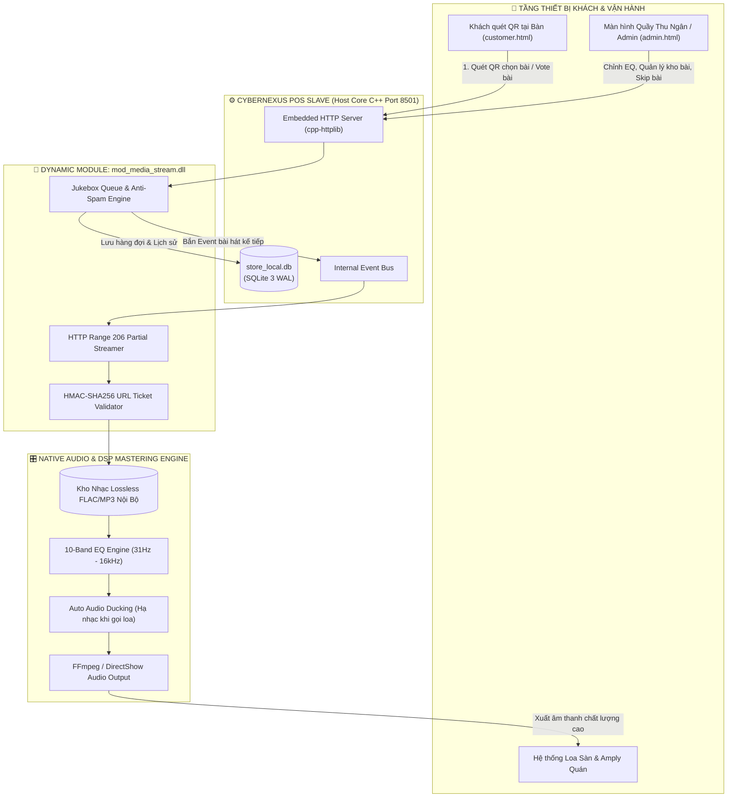
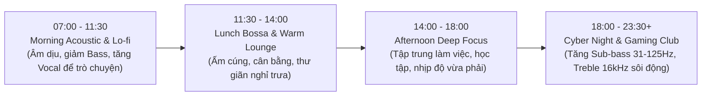
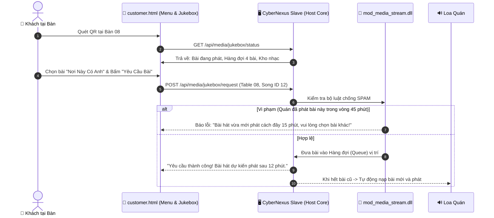

# 🎵 CYBERNEXUS OS — PHÂN TÍCH & KỊCH BẢN VẬN HÀNH MEDIA SERVER & SMART JUKEBOX

> **Hệ sinh thái:** CyberNexus OS — Trung tâm Giải trí Đa phương tiện Nội bộ  
> **Phân hệ tích hợp:** `mod_media_stream` (C++ Dynamic DLL) + Hybrid Audio Engine + QR Jukebox Khách Hàng  
> **Phiên bản tài liệu:** v1.0.0 | Ngày ban hành: 10/11/2026  

---

## 📋 MỤC LỤC
1. [Bối Cảnh & Đặt Vấn Đề](#1-bối-cảnh--đặt-vấn-đề)
2. [Kiến Trúc Tích Hợp Hệ Thống](#2-kiến-trúc-tích-hợp-hệ-thống)
3. [Kịch Bản 1: Streaming Nhạc / Video Nội Bộ & Bảo Mật HMAC-SHA256](#3-kịch-bản-1-streaming-nhạc--video-nội-bộ)
4. [Kịch Bản 2: Bộ Xử Lý Âm Thanh Chuyên Nghiệp (10-Band DSP Equalizer)](#4-kịch-bản-2-bộ-xử-lý-âm-thanh-10-band-dsp-equalizer)
5. [Kịch Bản 3: Jukebox Thông Minh (Khách Quét QR Bàn Chọn Bài & Bầu Chọn)](#5-kịch-bản-3-jukebox-thông-minh-qr-chọn-bài)
6. [Kịch Bản 4: Tương Tác Hợp Nhất Đa Phân Hệ (POS + Network QoS + Media)](#6-kịch-bản-4-tương-tác-hợp-nhất-đa-phân-hệ)
7. [Cơ Sở Dữ Liệu & Thiết Kế Lược Đồ (SQLite Schema)](#7-cơ-sở-dữ-liệu--thiết-kế-lược-đồ)
8. [Kế Hoạch Triển Khai Kỹ Thuật (Implementation Roadmap)](#8-kế-hoạch-triển-khai-kỹ-thuật)

---

## 1. BỐI CẢNH & ĐẶT VẤN ĐỀ

Tại các không gian kinh doanh dịch vụ cao cấp (Cyber Gaming Lounge, Billiards Club, Acoustic Cafe, Smart Pub), âm nhạc và video không chỉ là yếu tố phụ trợ mà là **linh hồn giữ chân khách hàng (Customer Retention)**. Tuy nhiên, các quán hiện nay đang gặp 4 điểm nghẽn chí mạng:

1. **Phụ thuộc hoàn toàn vào Internet & YouTube/Spotify**: Khi đứt cáp quang hoặc mạng chập chờn, nhạc bị gián đoạn, quảng cáo YouTube chen ngang gây tụt cảm xúc của khách.
2. **Âm thanh phẳng, chói gắt, không tối ưu theo khung giờ**: Không có Equalizer chuyên dụng để bù trừ âm học không gian (phòng kính, phòng cách âm, sảnh đông người).
3. **Thiếu tính tương tác gắn kết (Customer Engagement)**: Khách muốn nghe bài yêu thích phải gọi nhân viên hoặc tự bật điện thoại cá nhân gây loãng không gian quán.
4. **Phân mảnh với hệ thống POS**: Không có sự liên kết giữa mức chi tiêu của khách và quyền lợi giải trí (khách VIP gọi đồ nhiều vẫn không được ưu tiên dịch vụ).

**Giải pháp của CyberNexus OS:** Hợp nhất Media Streaming Server vào làm 1 Dynamic Module (`mod_media_stream.dll`), khai thác kho nhạc Lossless nội bộ (Offline 100%), trang bị bộ 10-Band DSP Mastering Equalizer và biến điện thoại của khách thành chiếc **Jukebox thông minh tương tác 2 chiều**.

---

## 2. KIẾN TRÚC TÍCH HỢP HỆ THỐNG



---

## 3. KỊCH BẢN 1: STREAMING NHẠC / VIDEO NỘI BỘ

### 3.1. Đặc tính Kỹ thuật
* **Offline 100%:** Toàn bộ thư viện bài hát (FLAC, WAV, MP3 320kbps) và video nền (MP4 1080p 60fps) được lưu trữ trực tiếp trên ổ cứng SSD của máy chủ quán (`slave/media_vault/`).
* **Chuẩn HTTP Range Requests (RFC 7233):** Phản hồi mã `206 Partial Content`, cho phép client tua tức thì không trễ, buffer siêu nhẹ và tiết kiệm tối đa RAM.
* **Bảo mật URL bằng HMAC-SHA256 Streaming Ticket:**
  - Ngăn chặn triệt để tình trạng khách cào trộm (scrape) hoặc tải lậu kho nhạc độc quyền của quán.
  - Mỗi link stream có dạng:
    ```text
    /api/media/stream?id=108&ticket=eyJhbGciOiJIUzI1NiJ9.eyJpZCI6MTA4LCJleHAiOjE3OTQzMjAwMDB9.a8f9c...
    ```
  - Ticket ràng buộc `media_id`, `client_ip` và có thời hạn sống TTL ngắn (15 - 30 phút). Nếu IP không khớp hoặc quá hạn, Host Core từ chối truy cập.

---

## 4. KỊCH BẢN 2: BỘ XỬ LÝ ÂM THANH 10-BAND DSP EQUALIZER

### 4.1. Ma trận 10 dải tần âm học (Bands Breakdown)

| Dải Tần | Phân Vùng Âm Thanh | Ý Nghĩa Âm Học & Cảm Xúc |
| :---: | :---: | :--- |
| **31 Hz** | Sub-Bass Sâu | Tiếng rung trầm uy lực của nhạc điện tử EDM, Trap, Gaming. |
| **62 Hz** | Bass Trầm | Lực nảy của trống kick drum, tạo nhịp điệu kích thích. |
| **125 Hz** | Upper Bass | Độ dày của tiếng đàn Bass guitar, tạo sự ấm cúng, đầy đặn. |
| **250 Hz** | Low-Mid | Độ ấm của giọng hát nam, tiếng đàn Guitar thùng. |
| **500 Hz** | Mid Trung Tâm | Sự tự nhiên của giọng hát (Vocal), tiếng piano, kèn saxophone. |
| **1 kHz** | High-Mid | Độ nổi của lời bài hát, giúp câu từ nghe rõ ràng trong không gian ồn ào. |
| **2 kHz** | Upper-Mid | Độ sắc nét của nhạc cụ (cần kiểm soát tránh chói gắt khi quán đông). |
| **4 kHz** | Presence | Độ hiện diện và độ mở của sân khấu âm thanh. |
| **8 kHz** | Treble Sáng | Tiếng leng keng của bộ gõ hi-hat, cymbal, tạo sự bay bổng. |
| **16 kHz** | Air / Siêu Tép | Độ tơi xốp, cảm giác không gian thoáng đãng, sang trọng (Hi-End). |

### 4.2. Cấu hình Preset mượt mà theo nhịp sinh học quán (Time-based Smart Auto Presets)



* **Preset 1 — Morning Chill / Acoustic:**
  - Sub-Bass giảm nhẹ (-3dB) để không rung bàn ghế.
  - Mid & High (+2dB) làm nổi bật giọng ca sĩ, tạo cảm giác trong lành đầu ngày.
* **Preset 2 — Cyberpunk Gaming / EDM (Đỉnh Cao Giờ Tối):**
  - Sub-Bass (+5dB tại 31Hz & 62Hz) tạo nhịp tim đập phấn khích.
  - Air Treble (+3dB tại 8kHz & 16kHz) sắc nét từng tiếng bước chân, combat trong game.
* **Tự động chuyển cấu hình (Smart Scheduler):** Module tự động chuyển đổi EQ Preset theo đồng hồ hệ thống mà không cần nhân viên can thiệp thủ công.

---

## 5. KỊCH BẢN 3: JUKEBOX THÔNG MINH (QR CHỌN BÀI)

### 5.1. Quy trình trải nghiệm của khách hàng (Customer Journey)



### 5.2. Bộ Quy Tắc Chống Phá Hoại Âm Thanh (Anti-Troll & Sound Governance Rules)
Để ngăn chặn tình trạng khách phá rối (chọn 1 bài liên tục 10 lần, hoặc chọn bài không phù hợp phong cách quán):
1. **Cooldown Per Table (Thời gian giãn cách):** Mỗi bàn chỉ được quyền gửi yêu cầu 1 bài sau mỗi **15 phút**.
2. **Duplicate Cooldown (Chống lặp bài):** Một bài hát sau khi phát xong sẽ bị khóa trong **45 phút** trước khi có thể được yêu cầu lại.
3. **Blacklist & Content Guard (Kiểm duyệt nội dung):** Quán chỉ cho phép chọn các bài có trong kho nhạc kiểm duyệt sẵn của quán (`Media Catalog`). Khách không được tự ý tải file bậy bạ lên loa quán.
4. **Quyền Can Thiệp Khẩn Cấp Của Thu Ngân / Chủ Quán:**
   - Trên [`admin.html`](file:///X:/My%20Drive/Code%20dev/cybernexus-os/slave/web/admin.html), thu ngân có nút **[Bỏ Qua / Skip]** bài hát đang phát nếu thấy khách xung quanh phàn nàn.
   - Nút **[Tạm Dừng Jukebox]** vào các khung giờ tổ chức sự kiện hoặc sinh nhật.

---

## 6. KỊCH BẢN 4: TƯƠNG TÁC HỢP NHẤT ĐA PHÂN HỆ (POS + NETWORK + MEDIA)

Sức mạnh thực sự của CyberNexus OS nằm ở **sự phối hợp liên phân hệ (Cross-Module Orchestration)**:

### 6.1. Chi Tiêu Nhiều = Đặc Quyền Âm Nhạc (POS Loyalty to Jukebox VIP)
* Khi khách thanh toán hóa đơn trên **200.000 VNĐ** tại quán:
  - Hệ thống tự động cấp cho bàn đó 1 vé **"VIP Priority Pass"**.
  - Bài hát do bàn đó yêu cầu sẽ được **đẩy thẳng lên vị trí tiếp theo (#1 Queue)** mà không cần xếp hàng chờ 4-5 bài khác.
  - Trên màn hình LED quảng cáo hoặc thanh trạng thái Jukebox hiển thị:
    > *"Bài hát tiếp theo được tài trợ bởi Khách VIP Bàn 08!"*

### 6.2. Cơ chế Hạ Nhạc Tự Động (Auto Audio Ducking)
* Khi quầy thu ngân bấm gọi món trên POS hoặc KDS nhà bếp thông báo:
  > *"Mời khách hàng số thẻ 15 đến quầy nhận đồ uống!"*
* Audio Engine tự động hạ âm lượng nhạc nền xuống **20% trong vòng 4 giây**, phát xong lời thông báo giọng đọc AI thì nhạc nền tự động chuyển mượt (smooth fade-in) trở lại 100%.

---

## 7. CƠ SỞ DỮ LIỆU & THIẾT KẾ LƯỢC ĐỒ (SQLite Schema)

Các bảng dữ liệu được tích hợp trực tiếp vào file CSDL nhúng [`store_local.db`](file:///X:/My%20Drive/Code%20dev/cybernexus-os/slave/database/store_local.db):

```sql
-- 1. Bảng thư viện bài hát nội bộ
CREATE TABLE IF NOT EXISTS media_tracks (
    id INTEGER PRIMARY KEY AUTOINCREMENT,
    title TEXT NOT NULL,
    artist TEXT NOT NULL DEFAULT 'Various Artists',
    album TEXT,
    genre TEXT DEFAULT 'Acoustic',           -- Acoustic, Lofi, EDM, Pop, Rock
    duration_sec INTEGER NOT NULL DEFAULT 180,
    file_path TEXT NOT NULL,                 -- Đường dẫn tương đối trong slave/media_vault/
    bitrate INTEGER DEFAULT 320,             -- 320kbps, FLAC lossless
    cover_image TEXT,
    play_count INTEGER DEFAULT 0,
    is_active INTEGER DEFAULT 1,
    created_at DATETIME DEFAULT CURRENT_TIMESTAMP
);

-- 2. Bảng hàng đợi Jukebox thông minh
CREATE TABLE IF NOT EXISTS media_jukebox_queue (
    id INTEGER PRIMARY KEY AUTOINCREMENT,
    track_id INTEGER NOT NULL,
    table_id INTEGER NOT NULL,               -- Bàn nào yêu cầu
    table_name TEXT NOT NULL,
    customer_phone TEXT,
    is_priority INTEGER DEFAULT 0,           -- 1 = Khách VIP được ưu tiên phát ngay
    vote_count INTEGER DEFAULT 1,            -- Số lượt khách khác bấm thích (Vote up)
    status TEXT DEFAULT 'pending',           -- pending, playing, played, skipped
    requested_at DATETIME DEFAULT CURRENT_TIMESTAMP,
    played_at DATETIME,
    FOREIGN KEY (track_id) REFERENCES media_tracks(id)
);

-- 3. Bảng cấu hình Equalizer & Presets
CREATE TABLE IF NOT EXISTS media_eq_presets (
    id INTEGER PRIMARY KEY AUTOINCREMENT,
    preset_name TEXT NOT NULL,               -- Morning Chill, Cyber EDM, Vocal Focus
    preamp_gain REAL DEFAULT 0.0,            -- dB (-12.0 đến +12.0)
    band_31hz REAL DEFAULT 0.0,
    band_62hz REAL DEFAULT 0.0,
    band_125hz REAL DEFAULT 0.0,
    band_250hz REAL DEFAULT 0.0,
    band_500hz REAL DEFAULT 0.0,
    band_1khz REAL DEFAULT 0.0,
    band_2khz REAL DEFAULT 0.0,
    band_4khz REAL DEFAULT 0.0,
    band_8khz REAL DEFAULT 0.0,
    band_16khz REAL DEFAULT 0.0,
    is_default INTEGER DEFAULT 0
);
```

---

## 8. KẾ HOẠCH TRIỂN KHAI KỸ THUẬT (Roadmap)

| Bước | Hạng Mục Công Việc | Công Nghệ / File Liên Quan | Trạng Thái |
| :---: | :--- | :--- | :---: |
| **P1** | **Khởi tạo Schema CSDL & API Routes C++** | Thêm 3 bảng vào `store_local.db`; hoàn thiện HTTP routes trong `mod_media_stream.cpp` | Sẵn sàng |
| **P2** | **HTTP Range 206 Partial Content Streamer** | Viết streamer đọc chunk nhị phân siêu tốc trong C++ core | Sẵn sàng |
| **P3** | **Tích hợp Giao Diện Jukebox Khách Hàng** | Bổ sung Tab "Âm Nhạc" vào `slave/web/customer.html` cho phép xem bài & yêu cầu | Kế tiếp |
| **P4** | **10-Band EQ Studio trên Admin Studio** | Giao diện thanh trượt Fader + biểu đồ đáp tuyến tần số cong (Bézier Curve) trên `slave/web/admin.html` | Kế tiếp |
| **P5** | **Liên kết Sự Kiện POS & Jukebox VIP** | Bắn Event Bus khi hóa đơn thanh toán để thưởng vé ưu tiên phát nhạc | Kế tiếp |

---
*Tài liệu được biên soạn đồng bộ với Kiến trúc Chuẩn Hóa C++17 Microkernel của dự án CyberNexus OS.*
