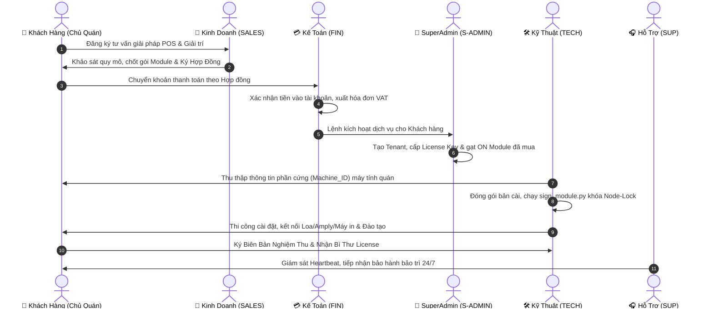
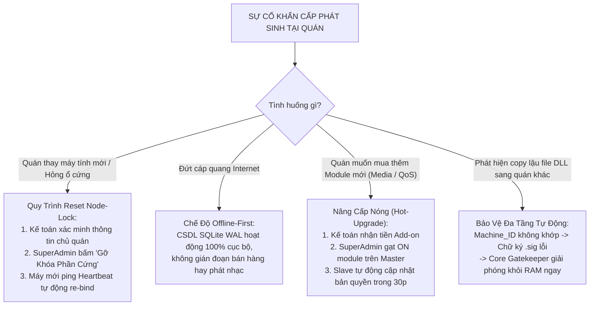

# 📋 QUY TRÌNH CHUẨN ĐÓNG GÓI BẢN PHẦN MỀM CẤP PHÉP, BÀN GIAO & VẬN HÀNH CHO KHÁCH HÀNG (SOP-CBNX-09)

> **Mã quy trình:** SOP-CBNX-09 | **Phiên bản:** v2.0 Enterprise  
> **Áp dụng cho:** Hệ thống CyberNexus OS — Nền tảng Quản trị & Giải trí Điểm Bán (POS & Smart Lounge Hub)  
> **Ngày ban hành:** 11/11/2026 | **Đơn vị ban hành:** Ban Quản Trị Hệ Thống SaaS Trung Tâm  
> **Nguyên tắc cốt lõi:** Phân tách bạch chức năng (Separation of Concerns) • Mật mã học Zero-Trust • Tối ưu hóa trải nghiệm khách hàng  

---

## 🎯 1. MỤC ĐÍCH & PHẠM VI ÁP DỤNG

### 1.1. Mục Đích
1. Chuẩn hóa 100% quy trình từ khâu chốt hợp đồng, thu tiền, cấp khóa bản quyền, đóng gói bộ phần mềm nhị phân (`.exe`, `.dll`, `.sig`) đến khâu cài đặt, kiểm thử và bàn giao cho Chủ quán (Tenant).
2. Thiết lập ranh giới trách nhiệm tuyệt đối giữa các phòng ban: **Kinh Doanh (Sales)**, **Kế Toán (Finance)**, **Kỹ Thuật Đóng Gói / Triển Khai (Deployment Tech)** và **Quản Trị Hệ Thống (SuperAdmin)**.
3. Ngăn chặn triệt để tình trạng:
   - Cài đặt phần mềm khi chưa thanh toán đủ hoặc chưa có hợp đồng pháp lý.
   - Sao chép lậu module trả phí (Media Server, Network QoS) giữa các quán.
   - Nhân viên kỹ thuật tự ý can thiệp mã nguồn hoặc chỉnh sửa thời hạn giấy phép.

### 1.2. Phạm Vi
Áp dụng cho toàn bộ hoạt động cung cấp bản quyền phần mềm mới, gia hạn định kỳ, nâng cấp module và bảo hành bảo trì của CyberNexus OS trên toàn quốc.

---

## 👥 2. MA TRẬN PHÂN QUYỀN & TRÁCH NHIỆM (RACI MATRIX)

| Mã Vai Trò | Bộ Phận Trách Nhiệm | Trách Nhiệm Chính Trong Quy Trình | Công Cụ & Thẩm Quyền |
| :---: | :--- | :--- | :--- |
| **SALES** | **Bộ phận Kinh Doanh** | Khảo sát nhu cầu quán, tư vấn gói giải pháp, thương thảo & ký Hợp đồng kinh tế. | Hợp đồng mẫu, Bảng báo giá niêm yết SaaS. |
| **FIN** | **Bộ phận Kế Toán** | Kiểm soát dòng tiền, xác nhận thanh toán, xuất hóa đơn VAT, phê duyệt lệnh cấp License. | Phần mềm Kế toán, Sao kê VietQR/Banking, Cổng Hóa đơn điện tử. |
| **S-ADMIN** | **SuperAdmin Hệ Thống** | Tạo Tenant trên SaaS Master (Port 8500), sinh khóa License Key, phân bổ hạn dùng và cấp quyền Module. | Cổng Master Dashboard (`/super_admin`), Database Master. |
| **TECH** | **Kỹ Thuật Triển Khai** | Lấy mã phần cứng (`Machine_ID`), chạy công cụ ký số `.sig`, đóng gói bộ cài, thi công hiện trường, kiểm thử 10 điểm. | Máy trạm đóng gói, Bộ công cụ `sign_module.py`, Cáp mạng, USB Setup. |
| **SUP** | **Hỗ Trợ & Bảo Trì (CSKH)** | Tiếp nhận ticket sự cố, hỗ trợ từ xa qua UltraViewer, bảo trì định kỳ, đề xuất gia hạn. | Hệ thống Helpdesk, Kênh Hotline 24/7. |

### Ma Trận Trách Nhiệm Chi Tiết (RACI):
* **R (Responsible):** Người trực tiếp thực hiện.
* **A (Accountable):** Người chịu trách nhiệm phê duyệt cuối cùng.
* **C (Consulted):** Người được tham vấn chuyên môn.
* **I (Informed):** Người nhận thông báo kết quả.

| Công Việc Cụ Thể | SALES | FIN | S-ADMIN | TECH | SUP |
| :--- | :---: | :---: | :---: | :---: | :---: |
| 1. Khảo sát quán & Ký kết Hợp đồng | **R / A** | C | I | C | I |
| 2. Tiếp nhận thanh toán & Xuất hóa đơn VAT | I | **R / A** | I | I | I |
| 3. Duyệt cấp License Key & Gói Module trên Master | I | C | **R / A** | I | I |
| 4. Khảo sát máy tính quán, lấy mã `Machine_ID` | I | I | I | **R / A** | I |
| 5. Đóng gói bộ phần mềm & Ký số `.sig` Node-Lock | I | I | I | **R / A** | I |
| 6. Cài đặt, kết nối máy in, âm ly, router tại quán | I | I | I | **R / A** | I |
| 7. Ký Biên bản nghiệm thu bàn giao kỹ thuật | **R** | I | I | **R** | I |
| 8. Bảo hành, hỗ trợ kỹ thuật và bảo trì định kỳ | I | I | I | C | **R / A** |

---

## 🔄 3. QUY TRÌNH 6 BƯỚC TRIỂN KHAI VẬN HÀNH TIÊU CHUẨN



---

### BƯỚC 1: TIẾP NHẬN YÊU CẦU, KHẢO SÁT & KÝ HỢP ĐỒNG (Bộ phận: SALES)
1. **Khảo sát hiện trường quán:**
   - Số lượng máy tính thu ngân, máy in nhiệt (LAN / USB / Bluetooth K80).
   - Hệ thống âm thanh quán (Amply, dàn loa vệ tinh, cổng 3.5mm/Optical).
   - Hạ tầng mạng Router (EdgeRouter ER-X / MikroTik / DrayTek).
2. **Xác định danh mục Module khách hàng lựa chọn:**
   - **Gói Cốt Lõi Bắt Buộc (Core):** `mod_pos_core` (Bán hàng, chia bàn, in bill).
   - **Các Module Gia Tăng Tùy Chọn (Add-on Modules):**
     - `mod_media_stream` (149.000đ/tháng): Máy chủ nhạc Lossless, 10-Band EQ, QR Jukebox.
     - `mod_network_qos` (199.000đ/tháng): Phân luồng router, cấp băng thông VIP.
     - `ai_invoice_ocr` (99.000đ/tháng): AI Gemini quét hóa đơn nhập kho.
3. **Ký kết hợp đồng:** Soạn thảo và ký kết **Hợp Đồng Dịch Vụ Phần Mềm (Mẫu HD-CBNX-01)** kèm phụ lục điều khoản cam kết SLA.

---

### BƯỚC 2: THANH TOÁN, ĐỐI SOÁT & XUẤT HÓA ĐƠN VAT (Bộ phận: KẾ TOÁN)
> [!IMPORTANT]
> **Quy Tắc Vàng Kế Toán:** Tuyệt đối không bàn giao mã bản quyền hoặc điều động kỹ thuật cài đặt khi tiền chưa về tài khoản ngân hàng của Công ty.

1. **Xác nhận giao dịch thanh toán:**
   - Đối soát mã tham chiếu chuyển khoản ngân hàng (Format: `TT HOPDONG [SO_HOP_DONG] [TEN_QUAN]`).
   - Kiểm tra số tiền khớp 100% với giá trị ghi trong hợp đồng (Bao gồm phí cài đặt + phí thuê bao kỳ đầu).
2. **Xuất hóa đơn tài chính (Hóa đơn điện tử VAT):**
   - Lập hóa đơn VAT dịch vụ phần mềm (Thuế suất 0% hoặc theo quy định hiện hành đối với sản phẩm phần mềm).
   - Gửi hóa đơn điện tử dạng PDF / XML qua email đăng ký của Chủ quán.
3. **Phê duyệt lệnh cấp License:**
   - Kế toán gửi phiếu yêu cầu cấp quyền (*Ticket Cấp Phép Bản Quyền*) chuyển tiếp sang SuperAdmin.

---

### BƯỚC 3: TẠO CỬA HÀNG & PHÂN QUYỀN TRÊN MASTER (Bộ phận: SUPERADMIN)
1. **Đăng nhập Cổng Master SaaS:** Truy cập `http://master.cybernexus.vn:8500/super_admin`.
2. **Khởi tạo hồ sơ Tenant:**
   - Nhập Mã định danh quán (ví dụ: `GP001`), Tên quán, Số hotline, Email chủ quán.
   - Chọn Gói dịch vụ và Thời hạn bản quyền tương ứng số tháng khách hàng đã trả tiền.
3. **Phân bổ Module cấp phép (Feature Toggle Matrix):**
   - Hệ thống tự động kích hoạt `mod_pos_core`.
   - Gạt **ON** chính xác các Module khách hàng đã mua trong hợp đồng (ví dụ: gạt ON `mod_media_stream`).
   - Các module khách **chưa mua** (ví dụ: `mod_network_qos`) giữ nguyên trạng thái **OFF**.
4. **Sinh khóa bản quyền (Generate Key):**
   - Bấm nút **"Cấp Lại License Mới"** để tạo mã khóa 24 ký tự (ví dụ: `CBNX-9A8B-7C6D-5E4F-3G2H`).
   - Trạng thái ban đầu: `Active | Node-Lock: Unbound (Chờ máy quán ping nhịp đầu để khóa cứng)`.

---

### BƯỚC 4: ĐÓNG GÓI BẢN CÀI ĐẶT & KÝ SỐ MẬT MÃ (Bộ phận: KỸ THUẬT)
> [!CAUTION]
> **Quy Tắc Bảo Vệ Nhị Phân:** Tuyệt đối không bỏ các file `.dll` trả phí vào bộ cài của quán nếu quán chưa đăng ký mua module đó trong hợp đồng!

1. **Cấu trúc thư mục đóng gói bàn giao chuẩn:**
   ```text
   CyberNexus_POS_Release_[TEN_QUAN]/
   ├── cybernexus_slave.exe          # File thực thi máy trạm (C++17 Native)
   ├── config.json                   # File cấu hình đã điền Tenant_ID & Master URL
   ├── RUN_SLAVE.bat                 # Phím tắt khởi động một chạm cho quán
   ├── STOP_ALL.bat                  # Phím tắt tắt an toàn máy chủ
   ├── Mo_Tuong_Lua_LAN.bat          # Mở cổng 8501 trên Windows Defender
   ├── database/
   │   └── store_local.db            # CSDL SQLite WAL cục bộ đã khởi tạo
   ├── modules/                      # THƯ MỤC CHỨA CÁC MODULE ĐƯỢC PHÉP
   │   ├── libmod_pos_core.dll       # Bắt buộc (Nhân bán hàng)
   │   ├── libmod_pos_core.dll.sig   # Chữ ký số toàn vẹn của Core
   │   │   # NẾU KHÁCH MUA MEDIA STREAM MỚI ĐƯỢC COPY 2 FILE DƯỚI ĐÂY:
   │   ├── libmod_media_stream.dll
   │   └── libmod_media_stream.dll.sig
   └── web/                          # Toàn bộ giao diện người dùng Liquid Glass
       ├── index.html                # Thu ngân POS
       ├── admin.html                # Quản trị quán
       ├── customer.html             # Menu số & QR Jukebox
       └── kitchen.html              # Màn hình bếp KDS
   ```

2. **Cấu hình `config.json`:**
   ```json
   {
     "store_tenant_id": "GP001",
     "license_key": "CBNX-9A8B-7C6D-5E4F-3G2H",
     "master_server_url": "http://master.cybernexus.vn:8500",
     "port": 8501,
     "auto_heartbeat": true
   }
   ```

3. **Thực thi quy trình Ký số Mật mã học (Cryptographic Signature):**
   - Kỹ thuật viên chạy công cụ đóng gói:
     ```bash
     python tools/sign_module.py slave/modules/libmod_media_stream.dll
     ```
   - Công cụ tự động sinh file `.sig` phong bì điện tử chứa mã băm SHA256 và chữ ký số HMAC của SuperAdmin Root Key.

---

### BƯỚC 5: THI CÔNG HIỆN TRƯỜNG, KIỂM THỬ 10 ĐIỂM & BÀN GIAO (Bộ phận: KỸ THUẬT)
Kỹ thuật viên trực tiếp (hoặc hỗ trợ từ xa) thực hiện quy trình cài đặt theo **Bảng Kiểm Thử 10 Điểm (10-Point Technical Checklist)**:

| Điểm Kiểm Thử | Hạng Mục Kiểm Tra | Tiêu Chuẩn Nghiệm Thu Đạt |
| :---: | :--- | :--- |
| **1** | Mở Port Tường Lửa LAN | Chạy `Mo_Tuong_Lua_LAN.bat`, điện thoại/máy tính bảng trong mạng LAN truy cập được cổng 8501. |
| **2** | Kích Hoạt Node-Lock | Bật `RUN_SLAVE.bat`, kiểm tra log hiển thị `[Heartbeat] Dong bo ban quyen thanh cong: Active`. |
| **3** | Khóa Cứng Phần Cứng | Master Dashboard nhận diện đúng tên máy tính `machine_name` và khóa cố định `machine_id`. |
| **4** | Nạp Đúng Module Đã Mua | Log hiển thị `[PluginManager] Nap thanh cong module: mod_media_stream` (và không có lỗi cảnh báo). |
| **5** | In Thử Hóa Đơn Nhiệt | Bấm in từ POS, máy in K80 cắt giấy chuẩn xác, mã VietQR in rõ nét quét thanh toán được ngay. |
| **6** | Âm Thanh & 10-Band EQ | Mở `admin.html`, gạt các cần Fader EQ 31Hz - 16kHz, dàn loa quán thay đổi chất âm lập tức. |
| **7** | QR Jukebox Khách Hàng | Dùng camera điện thoại quét mã QR Bàn 01, chọn bài hát thành công, hàng đợi admin nhận bài. |
| **8** | Chế Độ Auto Audio Ducking | Bấm gọi món trên POS, nhạc nền loa tự động giảm -10dB trong 4 giây rồi tăng âm trở lại. |
| **9** | Chế Độ Mất Mạng (Offline) | Rút dây mạng Internet quang, POS vẫn tạo đơn, bán hàng, in bill bình thường 100%. |
| **10** | Khởi Động Cùng Windows | Tạo Shortcut trong thư mục `shell:startup`, khởi động lại máy tính phần mềm tự chạy ngầm. |

---

### BƯỚC 6: NGHIỆM THU, BẢO HÀNH & BẢO TRÌ ĐỊNH KỲ (Bộ phận: TECH & CSKH)
1. **Lập Biên Bản Nghiệm Thu & Bàn Giao:**
   - Kỹ thuật viên và Chủ quán cùng ký vào **Biên Bản Nghiệm Thu & Bàn Giao Kỹ Thuật (Mẫu BB-CBNX-02)**.
   - Bàn giao Bì thư Niêm phong chứa thông tin bản quyền và tài khoản Quản trị quán.
2. **Bàn giao Bộ phận Hỗ Trợ Kỹ Thuật & CSKH (Ticket Handover):**
   - Đưa Tenant vào danh bạ giám sát của hệ thống Giám sát Vận hành Tự động (Monitoring Hub).
   - Nhắc nhở gia hạn trước 15 ngày khi hợp đồng sắp đến hạn.

---

## 📑 4. QUY CHUẨN BỘ HỒ SƠ TÀI LIỆU & HỢP ĐỒNG PHÁP LÝ

Mỗi khách hàng khi ký kết hợp tác phải có đầy đủ bộ hồ sơ gồm 4 tài liệu sau (Lưu trữ đồng thời bản cứng có dấu đỏ tại phòng Kế toán và bản số hóa trên Cloud):

```text
📁 HỒ SƠ KHÁCH HÀNG: [TEN_QUAN]_[MA_TENANT]/
├── 1. HOP_DONG_DICH_VU_PHAN_MEM_signed.pdf       (Hợp đồng MSA & SLA)
├── 2. HOA_DON_DIEN_TU_VAT.pdf                    (Hóa đơn tài chính Kế toán xuất)
├── 3. BIEN_BAN_BAN_GIAO_NGHIEM_THU_signed.pdf    (Biên bản kiểm thử 10 điểm ký nhận)
└── 4. PHIEU_XAC_NHAN_LICENSE_KEY_NIEM_PHONG.pdf   (Thông tin mã khóa & phần cứng đăng ký)
```

### Cam Kết Dịch Vụ Kỹ Thuật (SLA Matrix):
* **Sự cố Nghiêm Trọng (Mức 1 - POS không bán được hàng / không in được bill):** Phản hồi trong **5 phút**, khắc phục từ xa trong **30 phút**.
* **Sự cố Vừa (Mức 2 - Module phụ trợ Media / QoS gián đoạn):** Phản hồi trong **15 phút**, xử lý trong **2 giờ**.
* **Yêu cầu Hướng dẫn / Thay đổi cấu hình quán (Mức 3):** Xử lý trong giờ hành chính trong vòng **4 giờ**.

---

## 🚨 5. KỊCH BẢN XỬ LÝ SỰ CỐ BẢO HÀNH & TÌNH HUỐNG NGOẠI LỆ



### 5.1. Xử Lý Khi Quán Đổi Máy Tính Mới / Hỏng Bo Mạch Chủ (Hardware Reset)
1. Chủ quán gửi yêu cầu hỗ trợ qua số điện thoại chính chủ đã đăng ký trong hợp đồng.
2. Bộ phận Kỹ thuật kiểm tra trạng thái trên Master: Máy báo lỗi lệch `Machine_ID`.
3. Bộ phận Kế toán xác nhận quán không nợ cước thuê bao.
4. SuperAdmin mở Modal Chi tiết Tenant trên Master Dashboard ➔ Bấm nút **"Gỡ Khóa Phần Cứng (Reset Node-Lock)"**.
5. Kỹ thuật viên khởi động `cybernexus_slave.exe` trên máy tính mới ➔ Hệ thống tự động bắt cặp lại với phần cứng mới, khôi phục hoạt động kinh doanh chỉ trong **2 phút**.

### 5.2. Xử Lý Khi Quán Nâng Cấp Mua Thêm Module Trả Phí (Media Server / Network QoS)
* Quán **KHÔNG CẦN CÀI LẠI PHẦN MỀM**:
  1. Kế toán nhận tiền thanh toán gói Add-on và xuất hóa đơn bổ sung.
  2. SuperAdmin gạt switch **ON** module tương ứng trên Master Dashboard.
  3. Kỹ thuật viên gửi bổ sung file `libmod_media_stream.dll` kèm file chữ ký `.sig` vào thư mục `slave/modules/` (hoặc Slave tự động tải về qua OTA).
  4. Quán khởi động lại phần mềm là tính năng mới lập tức sáng đèn sử dụng ngay.

---

## 📌 6. ĐIỀU KHOẢN THI HÀNH & BẢO MẬT DOANH NGHIỆP

1. **Tuyệt đối bảo mật Master Root Secret:** Khóa ký số mật mã `CYBERNEXUS_SUPERADMIN_SIGNING_KEY` chỉ có Quản trị viên cấp cao nhất (SuperAdmin) được phép lưu trữ và cấu hình trên máy chủ Master. Kỹ thuật viên hiện trường không được phép nắm giữ khóa gốc này.
2. **Kiểm toán định kỳ (Audit Log):** Toàn bộ thao tác tạo tenant, đổi mã bản quyền, gỡ khóa phần cứng và bật/tắt module đều được máy chủ Master ghi nhật ký tự động vào bảng `saas_audit_logs` để phục vụ công tác thanh tra kế toán và an toàn thông tin.

---
*Tài liệu Quy trình Chuẩn SOP-CBNX-09 được lưu trữ chính thức tại thư mục `docs/` của dự án CyberNexus OS.*
