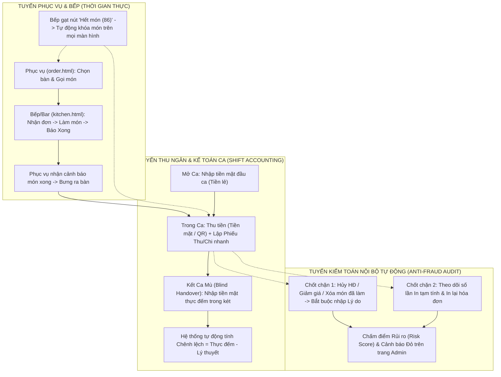

# 📓 NHẬT KÝ TRIỂN KHAI & QUY TRÌNH VẬN HÀNH THÔNG MINH — HỆ THỐNG CYBERNEXUS OS

> **Dự án:** CyberNexus OS — Hệ Điều Hành Quản Trị Điểm Bán, Giải Trí Đa Phương Tiện & Kiểm Toán Nội Bộ (Enterprise F&B POS)  
> **Mã hồ sơ:** `DOC-10-DEPLOYMENT-AND-AUDIT-LOG`  
> **Cập nhật lần cuối:** 12/11/2026 09:40 (GMT+7)  
> **Trạng thái tài liệu:** ✅ **HOÀN THÀNH & NGHIỆM THU TOÀN DIỆN (LIVE LOG)**  
> **Tài liệu liên kết:**
> - [`01_TONG_QUAN_KIEN_TRUC_HE_THONG.md`](01_TONG_QUAN_KIEN_TRUC_HE_THONG.md)
> - [`06_BAO_CAO_TIEN_DO_TRIEN_KHAI_LAN_1.md`](06_BAO_CAO_TIEN_DO_TRIEN_KHAI_LAN_1.md)
> - [`08_BAO_CAO_TIEN_DO_TRIEN_KHAI_LAN_2.md`](08_BAO_CAO_TIEN_DO_TRIEN_KHAI_LAN_2.md)
> - [`09_QUY_TRINH_DONG_GOI_BAN_GIAO_VA_VAN_HANH_KHACH_HANG.md`](09_QUY_TRINH_DONG_GOI_BAN_GIAO_VA_VAN_HANH_KHACH_HANG.md)

---

## 📌 MỤC LỤC
1. [Tổng hợp toàn bộ lịch sử triển khai (Từ Giai đoạn 1 đến Hiện tại)](#1-tổng-hợp-toàn-bộ-lịch-sử-triển-khai-từ-giai-đoạn-1-đến-hiện-tại)
2. [Chi tiết Đợt 3 (11/11 – 12/11/2026): Bảo mật Zero-Trust, Phân quyền RBAC & Chuẩn hóa UTF-8](#2-chi-tiết-đợt-3-1111--12112026-bảo-mật-zero-trust-phân-quyền-rbac--chuẩn-hóa-utf-8)
3. [Ma trận Phân quyền & Luồng Điều hướng Chuẩn giữa các Bộ phận](#3-ma-trận-phân-quyền--luồng-điều-hướng-chuẩn-giữa-các-bộ-phận)
4. [Thiết kế Quy trình Vận hành Thông minh, Kế toán Ca & Kiểm toán Nội bộ (Audit)](#4-thiết-kế-quy-trình-vận-hành-thông-minh-kế-toán-ca--kiểm-toán-nội-bộ-audit)
5. [Bảng theo dõi Tiến độ Triển khai tiếp theo (Live Roadmap Checklist)](#5-bảng-theo-dõi-tiến-độ-triển-khai-tiếp-theo-live-roadmap-checklist)

---

## 1. TỔNG HỢP TOÀN BỘ LỊCH SỬ TRIỂN KHAI (TỪ GIAI ĐOẠN 1 ĐẾN HIỆN TẠI)

| Giai đoạn | Thời gian | Hạng mục Trọng tâm | Trạng thái | Tập tin / Phân hệ chính |
| :--- | :---: | :--- | :---: | :--- |
| **Giai đoạn 1** | 09/11 – 10/11/2026 | • Kiến trúc Microkernel C++17 (`Master` Port 8500 & `Slave` Port 8501). • Hệ thống cấp phép bản quyền RSA-4096 Offline/Online (`LicenseService`). • CSDL SQLite WAL Mode hiệu năng cao, độc lập 100% Offline. • Hệ thống Dynamic DLL Plugin (`mod_pos_core`, `mod_network_qos`, `mod_ai_upsell`). | ✅ Hoàn thành | `master/`, `slave/`, `shared/`, `plugins/` |
| **Giai đoạn 2** | 10/11 – 11/11/2026 | • Hoàn thiện cổng SuperAdmin (`super_admin.html`): Gỡ khóa phần cứng (`reset_machine`) & Cấp lại License (`regenerate_key`). • Phân hệ Giải trí Đa phương tiện (`mod_media_stream.dll`): Kho nhạc Offline, Smart Jukebox tại bàn (`customer.html`), 10-Band DSP Equalizer Studio (`admin.html`). • Cross-Module Event Bus (`ORDER_PAID` $\ge 200.000\text{đ} \rightarrow$ VIP Priority Queue + Auto Audio Ducking). • Chữ ký số `.sig` chống sao chép lậu DLL & Đóng gói bản phát hành `GP001`. | ✅ Hoàn thành | `plugins/mod_media_stream/`, `master/packages/GP001/` |
| **Giai đoạn 2.5** | 11/11/2026 | • Tái cấu trúc giao diện Responsive & Liquid Glass cho `customer.html`, `admin.html` (Tab Âm nhạc & Jukebox). • Tích hợp **Mini-Player Jukebox & Trình quản lý Nhạc/EQ nổi** ngay trên màn hình Thu ngân (`index.html`). • Đồng bộ toàn bộ mã nguồn lên GitHub (`cybernexus-os`). | ✅ Hoàn thành | `slave/web/index.html`, `slave/web/customer.html`, `slave/web/admin.html` |
| **Giai đoạn 3** | 12/11/2026 | • **Bảo mật Phiên đăng nhập Zero-Trust**: Chặn tuyệt đối truy cập không đăng nhập trên mọi URL (`/`, `/index.html`, `/admin.html`, `/kitchen.html`, `/order.html`, `/online_orders.html`, `/customer.html`). • **Reset phiên khi khởi động**: `RUN_SLAVE.bat` tự động đóng tiến trình cũ, xóa sạch RAM sessions và chuyển Cookie thành Session Cookie. • **Định tuyến PIN chính xác**: `9999` $\rightarrow$ `admin.html`, `1111` $\rightarrow$ `index.html`, `2222`/`3333` $\rightarrow$ `order.html`, `4444` $\rightarrow$ `kitchen.html`. • **Huy hiệu Admin thông minh**: Tự động kiểm tra phiên và gắn huy hiệu `👑 Quản Trị Viên [ADMIN]` kế nút `Thoát` trên mọi trang chỉ khi đăng nhập bằng tài khoản `admin`. • **Khóa phân quyền RBAC 2 lớp** cho 4 bộ phận + Sửa lỗi UTF-8 Mojibake & bổ sung API Đơn Online. | ✅ Hoàn thành | `shared/src/auth.cpp`, `slave/src/main_slave.cpp`, `slave/src/slave_handlers.cpp`, `slave/web/*.html` |

---

## 2. CHI TIẾT ĐỢT 3 (11/11 – 12/11/2026): BẢO MẬT ZERO-TRUST, PHÂN QUYỀN RBAC & CHUẨN HÓA UTF-8

### 2.1. Nhật ký xử lý sự cố & Nâng cấp Bảo mật Phiên (Session Security)

#### 🔹 Vấn đề 1: Chạy `RUN_SLAVE.bat` và gõ `localhost:8501` hoặc `localhost:8501/index.html` vào thẳng trang POS không qua đăng nhập
- **Nguyên nhân gốc rễ:**
  1. Tiến trình `cybernexus_slave.exe` cũ vẫn chạy ngầm giữ các phiên trong RAM (`m_sessions`).
  2. Cookie `pos_token` có `maxAgeSecs = 30 ngày`, trình duyệt tự động gửi lại kèm HTML cũ lưu trong Disk Cache.
  3. Trang `/customer.html` trước đó mở tự do không qua kiểm tra phiên.
- **Giải pháp đã triển khai:**
  - Cập nhật `slave/RUN_SLAVE.bat` và `release/RUN_SLAVE.bat`: Thực thi `taskkill /F /IM cybernexus_slave.exe >nul 2>&1` trước khi khởi chạy máy chủ mới.
  - Cập nhật `shared/include/auth.hpp` & `shared/src/auth.cpp`: Bổ sung `AuthService::clearAllSessions()`, đổi mặc định `maxAgeSecs = 0` (Session Cookie — tự hủy khi đóng trình duyệt).
  - Cập nhật `slave/src/main_slave.cpp`:
    - Xóa toàn bộ phiên và reset `UPDATE users SET is_online = 0` ngay khi khởi động.
    - Bổ sung HTTP Header chống bộ nhớ đệm (`Cache-Control: no-store, no-cache, must-revalidate, max-age=0`, `Pragma: no-cache`, `Expires: 0`) trên tất cả các view.
    - Khi chưa đăng nhập, mọi truy cập đều trả về `HTTP 302 Location: /login.html`, xóa sạch Cookie (`pos_token`, `PHPSESSID`, `pos_remember`) và `localStorage`.

#### 🔹 Vấn đề 2: Đăng nhập mã PIN `9999` (Chủ quán) nhưng lại nhảy vào `index.html` (Thu ngân)
- **Nguyên nhân gốc rễ:** Khi truy cập `/index.html` lúc chưa đăng nhập, hệ thống chuyển hướng sang `/login.html?redirect=index.html`. Hàm `getRedirectTarget(user)` trong `login.html` ưu tiên tham số `?redirect=index.html` hơn vai trò thực tế của tài khoản.
- **Giải pháp đã triển khai:**
  - Sửa hàm `getRedirectTarget(user)` trong `slave/web/login.html`: Luôn định tuyến theo đúng vai trò (`role`) của người dùng vừa đăng nhập:
    - `admin` (`9999`) $\rightarrow$ `admin.html`
    - `cashier` (`1111`) $\rightarrow$ `index.html`
    - `waiter` (`2222`, `3333`) $\rightarrow$ `order.html`
    - `kitchen` (`4444`) $\rightarrow$ `kitchen.html`
    - `customer` (`0000`) $\rightarrow$ `customer.html`

#### 🔹 Vấn đề 3: Huy hiệu điều hướng nhanh về Quản trị dành riêng cho Admin
- **Yêu cầu:** Tất cả các trang khi load đều kiểm tra user trong phiên login; nếu là `admin` thì gắn huy hiệu `👑 Quản Trị Viên [ADMIN]` kế bên nút `Thoát` (`Logout`) để quay về `admin.html` ngay lập tức mà không lộ nút Quản trị cho nhân viên thường.
- **Giải pháp đã triển khai:**
  - Đồng bộ trên cả 5 trang (`index.html`, `kitchen.html`, `order.html`, `online_orders.html`, `customer.html`): Kiểm tra `u.role === 'admin' || u.is_super_admin === true`.
  - Khi đúng là Admin, thẻ huy hiệu biến thành liên kết `<a href="admin.html" title="Quay về Bảng Điều Khiển Quản Trị Hệ Thống">` với hiệu ứng viền vàng Hoàng gia. Nhân viên các bộ phận khác hoàn toàn không thấy liên kết này.

#### 🔹 Vấn đề 4: Khóa phân quyền điều hướng giữa các bộ phận & Sửa lỗi trang "Đơn Online"
- **Nguyên nhân gốc rễ:**
  1. `main_slave.cpp` trước đó cấu hình `serveProtectedView("index", "any")`, cho phép cả `waiter` và `kitchen` gõ `/index.html` để vào trang Thu ngân.
  2. Trang `online_orders.html` gọi `GET api/orders.php?action=online_orders&status=active`, nhưng action `online_orders` chưa được định nghĩa trong `ApiHandlers::handleOrders` (`slave_handlers.cpp`), dẫn đến rơi vào nhánh báo lỗi mặc định bị lỗi mã hóa kép UTF-8 (`"Yêu cầu hóa Ä‘Æ¡n không hợp lệ!"`).
- **Giải pháp đã triển khai:**
  1. **Chuẩn hóa 100% chuỗi UTF-8 trong C++ Backend**: Quét và khôi phục toàn bộ 1.048 chuỗi tiếng Việt bị lỗi double-encoding trong `slave/src/slave_handlers.cpp`, `master/src/master_handlers.cpp`, `shared/src/PluginManager.cpp`.
  2. **Bổ sung API Đơn Online trong `slave/src/slave_handlers.cpp`**:
     - `GET api/orders.php?action=online_orders`: Truy vấn danh sách đơn mang về/online (`active` hoặc `today`) kèm tóm tắt món (`items_summary`) và số điện thoại khách.
     - `POST api/orders.php` (`action = "online_order_delivered"`): Xác nhận bàn giao đơn, cập nhật `kitchen_status = 'served'`, `served_at` và ghi log kiểm toán vào bảng `kitchen_service_logs`.
  3. **Gỡ bỏ các nút điều hướng thừa trên giao diện**:
     - Trang `online_orders.html`: Gỡ bỏ nút `Quản Trị` và nút `Thu Ngân`.
     - Trang `kitchen.html`: Gỡ bỏ nút `Phục Vụ` (`order.html`) và nút QR, chỉ giữ thuần túy chức năng Bếp / Pha chế.
     - Trang `order.html`: Gỡ bỏ nút `Bếp` (`kitchen.html`) và `Đơn Online` (`online_orders.html`), chỉ giữ thuần túy chức năng Order phục vụ.

---

## 3. MA TRẬN PHÂN QUYỀN & LUỒNG ĐIỀU HƯỚNG CHUẨN GIỮA CÁC BỘ PHẬN

Hệ thống áp dụng cơ chế bảo vệ **2 lớp đồng thời** (Server-side C++ HTTP 302 Redirect trong `main_slave.cpp` + Client-side `<head>` Auth-Cloak Redirect):

| Bộ phận | Vai trò (`role`) | Mã PIN | Trang chủ mặc định | `admin.html` (Quản trị) | `index.html` (Thu ngân POS) | `online_orders.html` (Đơn Online) | `kitchen.html` (Bếp / Bar) | `order.html` (Phục vụ) | `customer.html` (Menu QR) |
| :--- | :---: | :---: | :---: | :---: | :---: | :---: | :---: | :---: | :---: |
| **1. Chủ quán / Quản trị** | `admin` | `9999` | `admin.html` | ✅ Toàn quyền | ✅ Toàn quyền (+ Huy hiệu `ADMIN`) | ✅ Toàn quyền (+ Huy hiệu `ADMIN`) | ✅ Toàn quyền (+ Huy hiệu `ADMIN`) | ✅ Toàn quyền (+ Huy hiệu `ADMIN`) | ✅ Toàn quyền (+ Huy hiệu `ADMIN`) |
| **2. Thu ngân** | `cashier` | `1111` | `index.html` | ⛔ Chặn ($\rightarrow$ `index.html`) | ✅ Trang chính (POS, Jukebox, Lịch sử, Thống kê) | ✅ Được phép | ✅ Được phép | ✅ Được phép | ✅ Được phép |
| **3. Tổ Bếp & Pha chế** | `kitchen` | `4444` | `kitchen.html` | ⛔ Chặn ($\rightarrow$ `kitchen.html`) | ⛔ Chặn ($\rightarrow$ `kitchen.html`) | ⛔ Chặn ($\rightarrow$ `kitchen.html`) | ✅ Trang duy nhất | ⛔ Chặn ($\rightarrow$ `kitchen.html`) | ✅ Được phép |
| **4. Phục vụ chạy bàn** | `waiter` | `2222`, `3333` | `order.html` | ⛔ Chặn ($\rightarrow$ `order.html`) | ⛔ Chặn ($\rightarrow$ `order.html`) | ⛔ Chặn ($\rightarrow$ `order.html`) | ⛔ Chặn ($\rightarrow$ `order.html`) | ✅ Trang duy nhất | ✅ Được phép |

---

## 4. THIẾT KẾ QUY TRÌNH VẬN HÀNH THÔNG MINH, KẾ TOÁN CA & KIỂM TOÁN NỘI BỘ (AUDIT)

### 4.1. Sơ đồ Luồng Vận hành & Đối soát Chống thất thoát Khép kín

### 4.2. Chi tiết 3 Phân hệ Nâng cấp Thông minh

#### A. Phân hệ Kiểm toán Nội bộ (`Audit Trail & Anti-Fraud`)
- **Bảng CSDL `audit_logs` (Bất biến - Append-only)**:
  - Lưu trữ: `id`, `created_at`, `user_id`, `user_fullname`, `user_role`, `action_code`, `severity` (`INFO`, `WARN`, `CRITICAL`), `order_id`, `table_name`, `amount_impact`, `reason`, `details_json`.
- **Các sự kiện tự động bắt lỗi & gắn cờ (`severity = CRITICAL / WARN`)**:
  1. `VOID_ORDER`: Hủy hóa đơn (Đặc biệt nghiêm trọng nếu bàn đã từng bấm *In tạm tính*).
  2. `REMOVE_COOKED_ITEM`: Xóa hoặc giảm số lượng món khi Bếp đã chuyển trạng thái sang *Đang làm* hoặc *Đã xong*.
  3. `MANUAL_DISCOUNT`: Áp dụng giảm giá thủ công.
  4. `REPRINT_RECEIPT`: In lại hóa đơn đã thanh toán hoặc in tạm tính nhiều lần.
  5. `SHIFT_DISCREPANCY`: Chênh lệch tiền mặt khi kết ca vượt ngưỡng cho phép.

#### B. Phân hệ Kế toán Ca & Sổ quỹ (`Shift Accounting & Cashflow`)
- **Bảng CSDL `pos_shifts` (Quản lý Ca làm việc)** & **`cash_transactions` (Phiếu Thu / Chi tại quầy)**:
  - Quản lý trọn vẹn vòng đời ca làm việc của Thu ngân: **Mở ca (Opening Cash)** $\rightarrow$ **Thu bán hàng (Cash / Transfer / Card)** $\rightarrow$ **Chi nội bộ trong ca (Mua đá, nguyên liệu phụ, ứng tiền...)** $\rightarrow$ **Kết ca đối soát (Closing Actual Cash vs Expected Cash)**.
- **Báo cáo Kế toán trong `admin.html`**:
  - Bảng đối soát lịch sử giao ca (Ca nào thừa/thiếu bao nhiêu tiền, ai trực ca).
  - Sổ quỹ Thu - Chi tiền mặt & Chuyển khoản.

#### C. Tự động hóa Phối hợp Bếp – Phục vụ – Thu ngân
- **Báo hết món tức thời (`86 / Out-of-Stock Toggle`) ngay tại Bếp (`kitchen.html`)**:
  - Nhân viên Bếp/Pha chế chỉ cần bấm 1 nút để đánh dấu món *Tạm hết* (hoặc *Còn hàng trở lại*) mà không cần nhờ Admin vào trang quản trị sửa menu.
  - Màn hình Phục vụ (`order.html`), Thu ngân (`index.html`) và Khách hàng (`customer.html`) tự động làm mờ và khóa nút gọi món đó ngay lập tức.
- **Thông báo Món đã xong trên sơ đồ bàn (`order.html` & `index.html`)**:
  - Hiển thị huy hiệu số món Bếp vừa hoàn tất ngay trên ô bàn để Phục vụ bưng ra ngay, không để đồ uống tan đá.

---

## 5. KẾT QUẢ TRIỂN KHAI & NGHIỆM THU PHÂN HỆ KẾ TOÁN CA, SỔ QUỸ & KIỂM TOÁN NỘI BỘ (12/11/2026)

- [x] **Bước 0 (12/11/2026 09:20):** Tổng hợp toàn bộ lịch sử hệ thống và khởi tạo hồ sơ Nhật ký triển khai [`docs/10_NHAT_KY_TRIEN_KHAI_VA_VAN_HANH_HE_THONG.md`](10_NHAT_KY_TRIEN_KHAI_VA_VAN_HANH_HE_THONG.md).
- [x] **Bước 1 (12/11/2026 09:31):** Thiết lập CSDL & C++ API cho **Kiểm toán Nội bộ (`audit_logs`)** và **Kế toán Ca / Sổ quỹ (`pos_shifts`, `cash_transactions`)** trong [`slave/src/main_slave.cpp`](../slave/src/main_slave.cpp) và [`slave/src/slave_handlers.cpp`](../slave/src/slave_handlers.cpp):
  - Tự động khởi tạo 3 bảng `audit_logs`, `pos_shifts`, `cash_transactions` ngay khi mở CSDL.
  - Bổ sung các API trong `ApiHandlers::handleFinance` (`shift_status`, `open_shift`, `add_cash_tx`, `close_shift`, `audit_and_shifts`) và `ApiHandlers::handleOrders` (`cancel_order` bắt buộc `reason`, `checkout` tự động ghi Audit khi giảm giá, `log_audit` ghi nhận In tạm tính & In lại hóa đơn).
- [x] **Bước 2 (12/11/2026 09:35):** Nâng cấp màn hình **Thu ngân ([`index.html`](../slave/web/index.html) & [`pos.js`](../slave/web/assets/js/pos.js))**:
  - Nâng cấp `POS.cancelOrder()` thành **Modal Xác Nhận Hủy Hóa Đơn (Audit)** bắt buộc chọn/nhập lý do giải trình trước khi hủy đơn.
  - Nâng cấp `POS.openDiscountModal()` & `POS.applyDiscount()` bắt buộc nhập **Lý do giảm giá / Chương trình KM** khi chiết khấu $>0$.
  - Tự động ghi log Kiểm toán khi Thu ngân bấm **In tạm tính (`PRINT_TEMP_BILL`)** hoặc **In lại hóa đơn (`REPRINT_RECEIPT`)**.
  - Bổ sung nút **`Giao Ca / Quỹ`** trên thanh Header của `index.html` cùng **Modal Quản Lý Ca & Sổ Quỹ Tiền Mặt** (Mở ca, Lập Phiếu Thu/Chi nhanh tự động đồng bộ sang Sổ chi phí Kế toán, Kết ca kiểm đếm tiền mặt thực tế & tính chênh lệch két).
- [x] **Bước 3 (12/11/2026 09:36):** Đồng bộ tức thời **"Báo hết món nhanh (86)"** từ màn hình **Bếp ([`kitchen.html`](../slave/web/kitchen.html))** sang toàn bộ các màn hình:
  - Ghi log Kiểm toán `LOCK_PRODUCT_86` / `UNLOCK_PRODUCT_86` trong `handleProducts`.
  - Bổ sung hàm `syncMenuLocks()` trong [`customer.js`](../slave/web/assets/js/customer.js) để tự động làm mờ và khóa nút chọn món trên màn hình QR Khách hàng ngay khi Bếp báo hết hàng (bên cạnh màn hình Phục vụ `order.html` và Thu ngân `index.html`).
- [x] **Bước 4 (12/11/2026 09:38):** Nâng cấp **Tab "Kế Toán Ca & Kiểm Toán (Audit)"** trong trang **Quản trị ([`admin.html`](../slave/web/admin.html) & [`admin.js`](../slave/web/assets/js/admin.js))**:
  - Bổ sung **4 Thẻ KPI Kiểm Toán Chống Thất Thoát**: Cảnh báo rủi ro cao (`CRITICAL`), Tổng hủy đơn (`VOID`), Tổng giảm giá thủ công, và Lệch két giao ca lũy kế.
  - Bổ sung **Bảng Nhật Ký Kiểm Toán Bất Biến (`audit_logs`)** theo dõi thời gian thực từng thao tác nhạy cảm kèm lý do giải trình và nhân viên thực hiện.
  - Bổ sung **Bảng Đối Soát Bàn Giao Ca & Két Tiền (`pos_shifts`)** đối chiếu Tiền đầu ca, Thu tiền mặt, Thu/Chi tại quầy, Tiền lý thuyết, Tiền thực đếm và Chênh lệch thừa/thiếu.
- [x] **Bước 5 (12/11/2026 09:40):** Biên dịch [`cybernexus_slave.exe`](../slave/cybernexus_slave.exe), đồng bộ đầy đủ sang `master/web/` và gói phát hành `GP001`, chạy kiểm thử tự động Playwright (`ALL SHIFT, CASHBOOK & AUDIT TESTS PASSED!`) và khởi động lại máy chủ ở trạng thái sạch.
