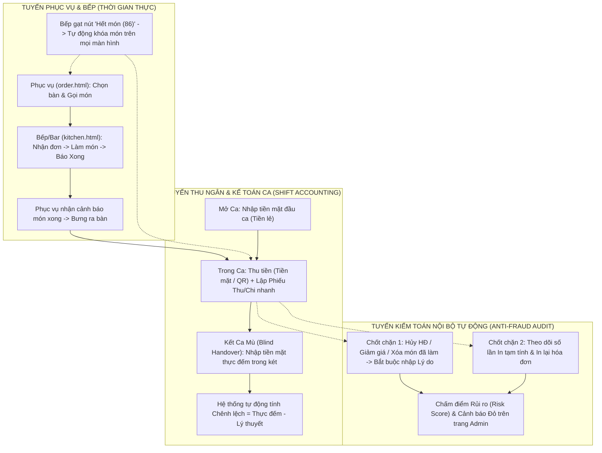

# 📓 NHẬT KÝ TRIỂN KHAI & QUY TRÌNH VẬN HÀNH THÔNG MINH — HỆ THỐNG CYBERNEXUS OS

> **Dự án:** CyberNexus OS — Hệ Điều Hành Quản Trị Điểm Bán, Giải Trí Đa Phương Tiện & Kiểm Toán Nội Bộ (Enterprise F&B POS)  
> **Mã hồ sơ:** `DOC-10-DEPLOYMENT-AND-AUDIT-LOG`  
> **Cập nhật lần cuối:** 12/11/2026 09:40 (GMT+7)  
> **Trạng thái tài liệu:** ✅ **HOÀN THÀNH & NGHIỆM THU TOÀN DIỆN (LIVE LOG)**  
> **Tài liệu liên kết:**
> - [`01_TONG_QUAN_KIEN_TRUC_HE_THONG.md`](01_TONG_QUAN_KIEN_TRUC_HE_THONG.md)
> - [`06_BAO_CAO_TIEN_DO_TRIEN_KHAI_LAN_1.md`](06_BAO_CAO_TIEN_DO_TRIEN_KHAI_LAN_1.md)
> - [`08_BAO_CAO_TIEN_DO_TRIEN_KHAI_LAN_2.md`](08_BAO_CAO_TIEN_DO_TRIEN_KHAI_LAN_2.md)
> - [`09_QUY_TRINH_DONG_GOI_BAN_GIAO_VA_VAN_HANH_KHACH_HANG.md`](09_QUY_TRINH_DONG_GOI_BAN_GIAO_VA_VAN_HANH_KHACH_HANG.md)

---

## 📌 MỤC LỤC
1. [Tổng hợp toàn bộ lịch sử triển khai (Từ Giai đoạn 1 đến Hiện tại)](#1-tổng-hợp-toàn-bộ-lịch-sử-triển-khai-từ-giai-đoạn-1-đến-hiện-tại)
2. [Chi tiết Đợt 3 (11/11 – 12/11/2026): Bảo mật Zero-Trust, Phân quyền RBAC & Chuẩn hóa UTF-8](#2-chi-tiết-đợt-3-1111--12112026-bảo-mật-zero-trust-phân-quyền-rbac--chuẩn-hóa-utf-8)
3. [Ma trận Phân quyền & Luồng Điều hướng Chuẩn giữa các Bộ phận](#3-ma-trận-phân-quyền--luồng-điều-hướng-chuẩn-giữa-các-bộ-phận)
4. [Thiết kế Quy trình Vận hành Thông minh, Kế toán Ca & Kiểm toán Nội bộ (Audit)](#4-thiết-kế-quy-trình-vận-hành-thông-minh-kế-toán-ca--kiểm-toán-nội-bộ-audit)
5. [Bảng theo dõi Tiến độ Triển khai tiếp theo (Live Roadmap Checklist)](#5-bảng-theo-dõi-tiến-độ-triển-khai-tiếp-theo-live-roadmap-checklist)

---

## 1. TỔNG HỢP TOÀN BỘ LỊCH SỬ TRIỂN KHAI (TỪ GIAI ĐOẠN 1 ĐẾN HIỆN TẠI)

| Giai đoạn | Thời gian | Hạng mục Trọng tâm | Trạng thái | Tập tin / Phân hệ chính |
| :--- | :---: | :--- | :---: | :--- |
| **Giai đoạn 1** | 09/11 – 10/11/2026 | • Kiến trúc Microkernel C++17 (`Master` Port 8500 & `Slave` Port 8501).<br>• Hệ thống cấp phép bản quyền RSA-4096 Offline/Online (`LicenseService`).<br>• CSDL SQLite WAL Mode hiệu năng cao, độc lập 100% Offline.<br>• Hệ thống Dynamic DLL Plugin (`mod_pos_core`, `mod_network_qos`, `mod_ai_upsell`). | ✅ Hoàn thành | `master/`, `slave/`, `shared/`, `plugins/` |
| **Giai đoạn 2** | 10/11 – 11/11/2026 | • Hoàn thiện cổng SuperAdmin (`super_admin.html`): Gỡ khóa phần cứng (`reset_machine`) & Cấp lại License (`regenerate_key`).<br>• Phân hệ Giải trí Đa phương tiện (`mod_media_stream.dll`): Kho nhạc Offline, Smart Jukebox tại bàn (`customer.html`), 10-Band DSP Equalizer Studio (`admin.html`).<br>• Cross-Module Event Bus (`ORDER_PAID` $\ge 200.000\text{đ} \rightarrow$ VIP Priority Queue + Auto Audio Ducking).<br>• Chữ ký số `.sig` chống sao chép lậu DLL & Đóng gói bản phát hành `GP001`. | ✅ Hoàn thành | `plugins/mod_media_stream/`, `master/packages/GP001/` |
| **Giai đoạn 2.5** | 11/11/2026 | • Tái cấu trúc giao diện Responsive & Liquid Glass cho `customer.html`, `admin.html` (Tab Âm nhạc & Jukebox).<br>• Tích hợp **Mini-Player Jukebox & Trình quản lý Nhạc/EQ nổi** ngay trên màn hình Thu ngân (`index.html`).<br>• Đồng bộ toàn bộ mã nguồn lên GitHub (`cybernexus-os`). | ✅ Hoàn thành | `slave/web/index.html`, `slave/web/customer.html`, `slave/web/admin.html` |
| **Giai đoạn 3** | 12/11/2026 | • **Bảo mật Phiên đăng nhập Zero-Trust**: Chặn tuyệt đối truy cập không đăng nhập trên mọi URL (`/`, `/index.html`, `/admin.html`, `/kitchen.html`, `/order.html`, `/online_orders.html`, `/customer.html`).<br>• **Reset phiên khi khởi động**: `RUN_SLAVE.bat` tự động đóng tiến trình cũ, xóa sạch RAM sessions và chuyển Cookie thành Session Cookie.<br>• **Định tuyến PIN chính xác**: `9999` $\rightarrow$ `admin.html`, `1111` $\rightarrow$ `index.html`, `2222`/`3333` $\rightarrow$ `order.html`, `4444` $\rightarrow$ `kitchen.html`.<br>• **Huy hiệu Admin thông minh**: Tự động kiểm tra phiên và gắn huy hiệu `👑 Quản Trị Viên [ADMIN]` kế nút `Thoát` trên mọi trang chỉ khi đăng nhập bằng tài khoản `admin`.<br>• **Khóa phân quyền RBAC 2 lớp** cho 4 bộ phận + Sửa lỗi UTF-8 Mojibake & bổ sung API Đơn Online. | ✅ Hoàn thành | `shared/src/auth.cpp`, `slave/src/main_slave.cpp`, `slave/src/slave_handlers.cpp`, `slave/web/*.html` |

---

## 2. CHI TIẾT ĐỢT 3 (11/11 – 12/11/2026): BẢO MẬT ZERO-TRUST, PHÂN QUYỀN RBAC & CHUẨN HÓA UTF-8

### 2.1. Nhật ký xử lý sự cố & Nâng cấp Bảo mật Phiên (Session Security)

#### 🔹 Vấn đề 1: Chạy `RUN_SLAVE.bat` và gõ `localhost:8501` hoặc `localhost:8501/index.html` vào thẳng trang POS không qua đăng nhập
- **Nguyên nhân gốc rễ:**
  1. Tiến trình `cybernexus_slave.exe` cũ vẫn chạy ngầm giữ các phiên trong RAM (`m_sessions`).
  2. Cookie `pos_token` có `maxAgeSecs = 30 ngày`, trình duyệt tự động gửi lại kèm HTML cũ lưu trong Disk Cache.
  3. Trang `/customer.html` trước đó mở tự do không qua kiểm tra phiên.
- **Giải pháp đã triển khai:**
  - Cập nhật `slave/RUN_SLAVE.bat` và `release/RUN_SLAVE.bat`: Thực thi `taskkill /F /IM cybernexus_slave.exe >nul 2>&1` trước khi khởi chạy máy chủ mới.
  - Cập nhật `shared/include/auth.hpp` & `shared/src/auth.cpp`: Bổ sung `AuthService::clearAllSessions()`, đổi mặc định `maxAgeSecs = 0` (Session Cookie — tự hủy khi đóng trình duyệt).
  - Cập nhật `slave/src/main_slave.cpp`:
    - Xóa toàn bộ phiên và reset `UPDATE users SET is_online = 0` ngay khi khởi động.
    - Bổ sung HTTP Header chống bộ nhớ đệm (`Cache-Control: no-store, no-cache, must-revalidate, max-age=0`, `Pragma: no-cache`, `Expires: 0`) trên tất cả các view.
    - Khi chưa đăng nhập, mọi truy cập đều trả về `HTTP 302 Location: /login.html`, xóa sạch Cookie (`pos_token`, `PHPSESSID`, `pos_remember`) và `localStorage`.

#### 🔹 Vấn đề 2: Đăng nhập mã PIN `9999` (Chủ quán) nhưng lại nhảy vào `index.html` (Thu ngân)
- **Nguyên nhân gốc rễ:** Khi truy cập `/index.html` lúc chưa đăng nhập, hệ thống chuyển hướng sang `/login.html?redirect=index.html`. Hàm `getRedirectTarget(user)` trong `login.html` ưu tiên tham số `?redirect=index.html` hơn vai trò thực tế của tài khoản.
- **Giải pháp đã triển khai:**
  - Sửa hàm `getRedirectTarget(user)` trong `slave/web/login.html`: Luôn định tuyến theo đúng vai trò (`role`) của người dùng vừa đăng nhập:
    - `admin` (`9999`) $\rightarrow$ `admin.html`
    - `cashier` (`1111`) $\rightarrow$ `index.html`
    - `waiter` (`2222`, `3333`) $\rightarrow$ `order.html`
    - `kitchen` (`4444`) $\rightarrow$ `kitchen.html`
    - `customer` (`0000`) $\rightarrow$ `customer.html`

#### 🔹 Vấn đề 3: Huy hiệu điều hướng nhanh về Quản trị dành riêng cho Admin
- **Yêu cầu:** Tất cả các trang khi load đều kiểm tra user trong phiên login; nếu là `admin` thì gắn huy hiệu `👑 Quản Trị Viên [ADMIN]` kế bên nút `Thoát` (`Logout`) để quay về `admin.html` ngay lập tức mà không lộ nút Quản trị cho nhân viên thường.
- **Giải pháp đã triển khai:**
  - Đồng bộ trên cả 5 trang (`index.html`, `kitchen.html`, `order.html`, `online_orders.html`, `customer.html`): Kiểm tra `u.role === 'admin' || u.is_super_admin === true`.
  - Khi đúng là Admin, thẻ huy hiệu biến thành liên kết `<a href="admin.html" title="Quay về Bảng Điều Khiển Quản Trị Hệ Thống">` với hiệu ứng viền vàng Hoàng gia. Nhân viên các bộ phận khác hoàn toàn không thấy liên kết này.

#### 🔹 Vấn đề 4: Khóa phân quyền điều hướng giữa các bộ phận & Sửa lỗi trang "Đơn Online"
- **Nguyên nhân gốc rễ:**
  1. `main_slave.cpp` trước đó cấu hình `serveProtectedView("index", "any")`, cho phép cả `waiter` và `kitchen` gõ `/index.html` để vào trang Thu ngân.
  2. Trang `online_orders.html` gọi `GET api/orders.php?action=online_orders&status=active`, nhưng action `online_orders` chưa được định nghĩa trong `ApiHandlers::handleOrders` (`slave_handlers.cpp`), dẫn đến rơi vào nhánh báo lỗi mặc định bị lỗi mã hóa kép UTF-8 (`"Yêu cầu hóa Ä‘Æ¡n không hợp lệ!"`).
- **Giải pháp đã triển khai:**
  1. **Chuẩn hóa 100% chuỗi UTF-8 trong C++ Backend**: Quét và khôi phục toàn bộ 1.048 chuỗi tiếng Việt bị lỗi double-encoding trong `slave/src/slave_handlers.cpp`, `master/src/master_handlers.cpp`, `shared/src/PluginManager.cpp`.
  2. **Bổ sung API Đơn Online trong `slave/src/slave_handlers.cpp`**:
     - `GET api/orders.php?action=online_orders`: Truy vấn danh sách đơn mang về/online (`active` hoặc `today`) kèm tóm tắt món (`items_summary`) và số điện thoại khách.
     - `POST api/orders.php` (`action = "online_order_delivered"`): Xác nhận bàn giao đơn, cập nhật `kitchen_status = 'served'`, `served_at` và ghi log kiểm toán vào bảng `kitchen_service_logs`.
  3. **Gỡ bỏ các nút điều hướng thừa trên giao diện**:
     - Trang `online_orders.html`: Gỡ bỏ nút `Quản Trị` và nút `Thu Ngân`.
     - Trang `kitchen.html`: Gỡ bỏ nút `Phục Vụ` (`order.html`) và nút QR, chỉ giữ thuần túy chức năng Bếp / Pha chế.
     - Trang `order.html`: Gỡ bỏ nút `Bếp` (`kitchen.html`) và `Đơn Online` (`online_orders.html`), chỉ giữ thuần túy chức năng Order phục vụ.

---

## 3. MA TRẬN PHÂN QUYỀN & LUỒNG ĐIỀU HƯỚNG CHUẨN GIỮA CÁC BỘ PHẬN

Hệ thống áp dụng cơ chế bảo vệ **2 lớp đồng thời** (Server-side C++ HTTP 302 Redirect trong `main_slave.cpp` + Client-side `<head>` Auth-Cloak Redirect):

| Bộ phận | Vai trò (`role`) | Mã PIN | Trang chủ mặc định | `admin.html` (Quản trị) | `index.html` (Thu ngân POS) | `online_orders.html` (Đơn Online) | `kitchen.html` (Bếp / Bar) | `order.html` (Phục vụ) | `customer.html` (Menu QR) |
| :--- | :---: | :---: | :---: | :---: | :---: | :---: | :---: | :---: | :---: |
| **1. Chủ quán / Quản trị** | `admin` | `9999` | `admin.html` | ✅ Toàn quyền | ✅ Toàn quyền (+ Huy hiệu `ADMIN`) | ✅ Toàn quyền (+ Huy hiệu `ADMIN`) | ✅ Toàn quyền (+ Huy hiệu `ADMIN`) | ✅ Toàn quyền (+ Huy hiệu `ADMIN`) | ✅ Toàn quyền (+ Huy hiệu `ADMIN`) |
| **2. Thu ngân** | `cashier` | `1111` | `index.html` | ⛔ Chặn ($\rightarrow$ `index.html`) | ✅ Trang chính (POS, Jukebox, Lịch sử, Thống kê) | ✅ Được phép | ✅ Được phép | ✅ Được phép | ✅ Được phép |
| **3. Tổ Bếp & Pha chế** | `kitchen` | `4444` | `kitchen.html` | ⛔ Chặn ($\rightarrow$ `kitchen.html`) | ⛔ Chặn ($\rightarrow$ `kitchen.html`) | ⛔ Chặn ($\rightarrow$ `kitchen.html`) | ✅ Trang duy nhất | ⛔ Chặn ($\rightarrow$ `kitchen.html`) | ✅ Được phép |
| **4. Phục vụ chạy bàn** | `waiter` | `2222`, `3333` | `order.html` | ⛔ Chặn ($\rightarrow$ `order.html`) | ⛔ Chặn ($\rightarrow$ `order.html`) | ⛔ Chặn ($\rightarrow$ `order.html`) | ⛔ Chặn ($\rightarrow$ `order.html`) | ✅ Trang duy nhất | ✅ Được phép |

---

## 4. THIẾT KẾ QUY TRÌNH VẬN HÀNH THÔNG MINH, KẾ TOÁN CA & KIỂM TOÁN NỘI BỘ (AUDIT)

### 4.1. Sơ đồ Luồng Vận hành & Đối soát Chống thất thoát Khép kín



### 4.2. Chi tiết 3 Phân hệ Nâng cấp Thông minh

#### A. Phân hệ Kiểm toán Nội bộ (`Audit Trail & Anti-Fraud`)
- **Bảng CSDL `audit_logs` (Bất biến - Append-only)**:
  - Lưu trữ: `id`, `created_at`, `user_id`, `user_fullname`, `user_role`, `action_code`, `severity` (`INFO`, `WARN`, `CRITICAL`), `order_id`, `table_name`, `amount_impact`, `reason`, `details_json`.
- **Các sự kiện tự động bắt lỗi & gắn cờ (`severity = CRITICAL / WARN`)**:
  1. `VOID_ORDER`: Hủy hóa đơn (Đặc biệt nghiêm trọng nếu bàn đã từng bấm *In tạm tính*).
  2. `REMOVE_COOKED_ITEM`: Xóa hoặc giảm số lượng món khi Bếp đã chuyển trạng thái sang *Đang làm* hoặc *Đã xong*.
  3. `MANUAL_DISCOUNT`: Áp dụng giảm giá thủ công.
  4. `REPRINT_RECEIPT`: In lại hóa đơn đã thanh toán hoặc in tạm tính nhiều lần.
  5. `SHIFT_DISCREPANCY`: Chênh lệch tiền mặt khi kết ca vượt ngưỡng cho phép.

#### B. Phân hệ Kế toán Ca & Sổ quỹ (`Shift Accounting & Cashflow`)
- **Bảng CSDL `pos_shifts` (Quản lý Ca làm việc)** & **`cash_transactions` (Phiếu Thu / Chi tại quầy)**:
  - Quản lý trọn vẹn vòng đời ca làm việc của Thu ngân: **Mở ca (Opening Cash)** $\rightarrow$ **Thu bán hàng (Cash / Transfer / Card)** $\rightarrow$ **Chi nội bộ trong ca (Mua đá, nguyên liệu phụ, ứng tiền...)** $\rightarrow$ **Kết ca đối soát (Closing Actual Cash vs Expected Cash)**.
- **Báo cáo Kế toán trong `admin.html`**:
  - Bảng đối soát lịch sử giao ca (Ca nào thừa/thiếu bao nhiêu tiền, ai trực ca).
  - Sổ quỹ Thu - Chi tiền mặt & Chuyển khoản.

#### C. Tự động hóa Phối hợp Bếp – Phục vụ – Thu ngân
- **Báo hết món tức thời (`86 / Out-of-Stock Toggle`) ngay tại Bếp (`kitchen.html`)**:
  - Nhân viên Bếp/Pha chế chỉ cần bấm 1 nút để đánh dấu món *Tạm hết* (hoặc *Còn hàng trở lại*) mà không cần nhờ Admin vào trang quản trị sửa menu.
  - Màn hình Phục vụ (`order.html`), Thu ngân (`index.html`) và Khách hàng (`customer.html`) tự động làm mờ và khóa nút gọi món đó ngay lập tức.
- **Thông báo Món đã xong trên sơ đồ bàn (`order.html` & `index.html`)**:
  - Hiển thị huy hiệu số món Bếp vừa hoàn tất ngay trên ô bàn để Phục vụ bưng ra ngay, không để đồ uống tan đá.

---

## 5. KẾT QUẢ TRIỂN KHAI & NGHIỆM THU PHÂN HỆ KẾ TOÁN CA, SỔ QUỸ & KIỂM TOÁN NỘI BỘ (12/11/2026)

- [x] **Bước 0 (12/11/2026 09:20):** Tổng hợp toàn bộ lịch sử hệ thống và khởi tạo hồ sơ Nhật ký triển khai [`docs/10_NHAT_KY_TRIEN_KHAI_VA_VAN_HANH_HE_THONG.md`](10_NHAT_KY_TRIEN_KHAI_VA_VAN_HANH_HE_THONG.md).
- [x] **Bước 1 (12/11/2026 09:31):** Thiết lập CSDL & C++ API cho **Kiểm toán Nội bộ (`audit_logs`)** và **Kế toán Ca / Sổ quỹ (`pos_shifts`, `cash_transactions`)** trong [`slave/src/main_slave.cpp`](../slave/src/main_slave.cpp) và [`slave/src/slave_handlers.cpp`](../slave/src/slave_handlers.cpp):
  - Tự động khởi tạo 3 bảng `audit_logs`, `pos_shifts`, `cash_transactions` ngay khi mở CSDL.
  - Bổ sung các API trong `ApiHandlers::handleFinance` (`shift_status`, `open_shift`, `add_cash_tx`, `close_shift`, `audit_and_shifts`) và `ApiHandlers::handleOrders` (`cancel_order` bắt buộc `reason`, `checkout` tự động ghi Audit khi giảm giá, `log_audit` ghi nhận In tạm tính & In lại hóa đơn).
- [x] **Bước 2 (12/11/2026 09:35):** Nâng cấp màn hình **Thu ngân ([`index.html`](../slave/web/index.html) & [`pos.js`](../slave/web/assets/js/pos.js))**:
  - Nâng cấp `POS.cancelOrder()` thành **Modal Xác Nhận Hủy Hóa Đơn (Audit)** bắt buộc chọn/nhập lý do giải trình trước khi hủy đơn.
  - Nâng cấp `POS.openDiscountModal()` & `POS.applyDiscount()` bắt buộc nhập **Lý do giảm giá / Chương trình KM** khi chiết khấu $>0$.
  - Tự động ghi log Kiểm toán khi Thu ngân bấm **In tạm tính (`PRINT_TEMP_BILL`)** hoặc **In lại hóa đơn (`REPRINT_RECEIPT`)**.
  - Bổ sung nút **`Giao Ca / Quỹ`** trên thanh Header của `index.html` cùng **Modal Quản Lý Ca & Sổ Quỹ Tiền Mặt** (Mở ca, Lập Phiếu Thu/Chi nhanh tự động đồng bộ sang Sổ chi phí Kế toán, Kết ca kiểm đếm tiền mặt thực tế & tính chênh lệch két).
- [x] **Bước 3 (12/11/2026 09:36):** Đồng bộ tức thời **"Báo hết món nhanh (86)"** từ màn hình **Bếp ([`kitchen.html`](../slave/web/kitchen.html))** sang toàn bộ các màn hình:
  - Ghi log Kiểm toán `LOCK_PRODUCT_86` / `UNLOCK_PRODUCT_86` trong `handleProducts`.
  - Bổ sung hàm `syncMenuLocks()` trong [`customer.js`](../slave/web/assets/js/customer.js) để tự động làm mờ và khóa nút chọn món trên màn hình QR Khách hàng ngay khi Bếp báo hết hàng (bên cạnh màn hình Phục vụ `order.html` và Thu ngân `index.html`).
- [x] **Bước 4 (12/11/2026 09:38):** Nâng cấp **Tab "Kế Toán Ca & Kiểm Toán (Audit)"** trong trang **Quản trị ([`admin.html`](../slave/web/admin.html) & [`admin.js`](../slave/web/assets/js/admin.js))**:
  - Bổ sung **4 Thẻ KPI Kiểm Toán Chống Thất Thoát**: Cảnh báo rủi ro cao (`CRITICAL`), Tổng hủy đơn (`VOID`), Tổng giảm giá thủ công, và Lệch két giao ca lũy kế.
  - Bổ sung **Bảng Nhật Ký Kiểm Toán Bất Biến (`audit_logs`)** theo dõi thời gian thực từng thao tác nhạy cảm kèm lý do giải trình và nhân viên thực hiện.
  - Bổ sung **Bảng Đối Soát Bàn Giao Ca & Két Tiền (`pos_shifts`)** đối chiếu Tiền đầu ca, Thu tiền mặt, Thu/Chi tại quầy, Tiền lý thuyết, Tiền thực đếm và Chênh lệch thừa/thiếu.
- [x] **Bước 5 (12/11/2026 09:40):** Biên dịch [`cybernexus_slave.exe`](../slave/cybernexus_slave.exe), đồng bộ đầy đủ sang `master/web/` và gói phát hành `GP001`, chạy kiểm thử tự động Playwright (`ALL SHIFT, CASHBOOK & AUDIT TESTS PASSED!`) và khởi động lại máy chủ ở trạng thái sạch.

---

## 6. KẾT QUẢ TRIỂN KHAI PHÂN HỆ ĐẠI LÝ PHÂN PHỐI & CẤP PHÉP BẢN QUYỀN (SUPERADMIN MASTER) (12/11/2026)

- [x] **Bước 1 (12/11/2026 10:05):** Khởi tạo cấu trúc CSDL và Schema Master trong [`master/src/main_master.cpp`](../master/src/main_master.cpp):
  - Bảng `saas_resellers`: Quản lý thông tin đối tác đại lý, cấp bậc phân hạng (Bronze 15%, Silver 25%, Gold 40%, Diamond 55%), mức chiết khấu thỏa thuận, số dư ví ký quỹ trả trước `wallet_balance`, trạng thái hoạt động.
  - Bảng `saas_reseller_wallet_logs`: Sổ cái tài chính bất biến ghi nhận mọi biến động nạp tiền ký quỹ (`deposit`) và trừ tiền khi cấp phép (`license_deduct`) kèm snapshot số dư trước/sau, mã license, tên quán và ghi chú.
  - Mở rộng bảng `saas_tenants`: Bổ sung 2 trường `reseller_id` (liên kết đại lý phụ trách) và `price_charged` (giá đại lý thực trả sau chiết khấu).
- [x] **Bước 2 (12/11/2026 10:15):** Xây dựng bộ API xử lý nghiệp vụ Kênh Đại lý trong [`master/src/master_handlers.cpp`](../master/src/master_handlers.cpp):
  - `get_resellers`: Trả về danh sách đại lý cùng subquery tính số lượng điểm quán đã cấp và tổng doanh thu thu được từ kênh đại lý.
  - `save_reseller`: Thêm mới hoặc cập nhật hồ sơ đại lý, phân hạng tier và phần trăm chiết khấu tự động, hỗ trợ cập nhật linh hoạt theo mã đại lý `DL-XXX`.
  - `deposit_reseller_wallet`: Nạp tiền vào ví ký quỹ đại lý (bằng chuyển khoản VietQR, tiền mặt hoặc bảo lãnh hợp đồng), tự động cộng số dư và ghi nhật ký sổ cái ví `saas_reseller_wallet_logs`.
  - `get_reseller_wallet_logs`: Tra cứu toàn bộ lịch sử biến động số dư theo từng đại lý hoặc toàn hệ thống.
  - `reseller_issue_license`: Nghiệp vụ cấp bản quyền cho điểm bán mới thông qua đại lý:
    - Kiểm tra số dư ví ký quỹ của đại lý theo công thức: $\text{Giá thực trừ} = \text{MSRP} \times (100 - \text{Discount}) / 100$.
    - Tự động trừ tiền ví đại lý và ghi nhận nhật ký biến động ví.
    - Sinh mã bản quyền chuẩn quốc tế `CBNX-XXXX-XXXX-XXXX-XXXX`.
    - Tạo hồ sơ cửa hàng `saas_tenants` với thời hạn hợp đồng tương ứng (1 tháng, 1 năm hoặc trọn đời) và kích hoạt trọn gói toàn bộ 10 module F&B.
    - Ghi nhận Audit Trail hệ thống.
- [x] **Bước 3 (12/11/2026 10:20):** Thiết kế giao diện Quản trị Đại lý Chuẩn Liquid Glass trong [`master/web/super_admin.html`](../master/web/super_admin.html) và [`master/web/assets/js/super_admin.js`](../master/web/assets/js/super_admin.js):
  - Bổ sung nút điều hướng sidebar **`Đại Lý Phân Phối`** với huy hiệu đếm số đại lý hoạt động theo thời gian thực.
  - Tab **`Quản Lý Đại Lý & Kênh Phân Phối`**:
    - 4 Thẻ KPI: Tổng Đại Lý, Tổng Số Dư Ký Quỹ Trong Ví (VNĐ), Tổng Điểm Quán Đã Cấp, Doanh Thu Thu Được.
    - Banner chính sách 4 cấp bậc đối tác (🥉 Đồng 15%, 🥈 Bạc 25%, 🥇 Vàng 40%, 💎 Kim Cương 55%).
    - Bảng danh sách đại lý tương tác: hiển thị mã ĐL, tên công ty, cấp bậc & chiết khấu, số dư ví khả dụng, số cửa hàng đã kéo, tổng tiền, trạng thái và cụm nút thao tác nhanh (Nạp Ví, Cấp Key, Lịch Sử Ví, Sửa).
  - 4 Modal nghiệp vụ chuyên sâu:
    - `modal-reseller-form`: Đăng ký / chỉnh sửa thông tin đại lý, tự động đổi chiết khấu khi chọn cấp bậc.
    - `modal-deposit-reseller-wallet`: Nạp tiền ví ký quỹ nhanh với các mốc tiền 5M, 15M, 30M, 60M hoặc tự nhập.
    - `modal-reseller-issue-license`: Cấp bản quyền cho quán mới: chọn đại lý $\rightarrow$ tự động tính chiết khấu và số tiền thực trừ ví theo thời gian thực $\rightarrow$ sinh mã License Key tức thì kèm nút sao chép 1 chạm.
    - `modal-reseller-wallet-logs`: Bảng tra cứu lịch sử nạp / trừ tiền chi tiết của đại lý.
- [x] **Bước 4 (12/11/2026 10:25):** Biên dịch [`master/cybernexus_master.exe`](../master/cybernexus_master.exe) qua CMake UCRT64, chạy daemon Master Server port 8500.
- [x] **Bước 5 (12/11/2026 10:30):** Kiểm thử tự động E2E:
  - Kiểm thử toàn diện API: Tạo đại lý `DL-001` (Gold 40%), nạp ví ký quỹ 20,000,000đ, cấp license 1 năm cho quán "The Coffee Garden - Quận 7" (MSRP 3.990.000đ, chiết khấu 40% $\rightarrow$ trừ ví 2.394.000đ, số dư ví còn lại 17.606.000đ), kích hoạt thành công license `CBNX-RXZF-0JTT-TGLG-75AE` qua `/api/license/verify` với đủ 10 modules.
  - Chụp ảnh màn hình nghiệm thu giao diện Playwright: Bảng đại lý, Modal cấp bản quyền, Modal biến động số dư ví.

---

## 7. KHẮC PHỤC LỖI TÍNH TOÁN SỐ TIỀN THANH TOÁN VIETQR TRÊN TRANG KHÁCH HÀNG (CUSTOMER.HTML) (12/11/2026)

- **Hiện tượng lỗi:** Khi khách hàng bấm nút nhanh `[VietQR]` trên thanh giỏ món (`customer.html`), modal QR hiển thị mặc định `Số tiền: 0đ` và không cập nhật theo tổng giá trị các món đang chọn (VD: 45.000 đ) do thẻ `` của `quick-vietqr-modal` bị gán tĩnh URL `amount=0` và hàm `showQuickVietQr()` chưa tính toán giỏ món.
- **Biện pháp xử lý & Nâng cấp:**
  - Bổ sung hàm `CustomerOrdering.getCartTotal()` trong [`slave/web/customer.html`](../slave/web/customer.html) để tính chính xác tổng tiền giỏ món đang chọn theo thời gian thực (kèm hỗ trợ fallback sang đơn hàng đã gửi `currentOrder.total_amount`).
  - Nâng cấp hàm `showQuickVietQr()`:
    - Kiểm tra giỏ hàng: nếu giỏ trống ($0$ đ), thông báo nhắc khách chọn món trước khi quét mã.
    - Lấy thông tin mã bàn / mã đơn từ URL hoặc phiên hiện tại (VD: `TT BAN MV1`).
    - Gọi API `/api/orders?action=vietqr&amount=...` để lấy cấu hình ngân hàng chuẩn từ hệ thống quán, tự động sinh chuỗi mã VietQR động theo chuẩn Napas247 với đúng số tiền và nội dung chuyển khoản.
    - Bổ sung khung hiển thị số tiền thanh toán rõ ràng (`#quick-vietqr-amount-display`) và thông tin tài khoản, nội dung CK trực tiếp trong modal.
  - Đồng bộ file sửa sang [`master/web/customer.html`](../master/web/customer.html) và gói phát hành [`CyberNexus_POS_Release_GP001/web/customer.html`](../master/packages/GP001/release/CyberNexus_POS_Release_GP001/web/customer.html).
  - Chạy kiểm thử tự động Playwright xác nhận mã VietQR sinh ra khớp hoàn toàn với số tiền giỏ món và nội dung bàn (`customer_vietqr_verified.png`).

---

## 8. TỐI ƯU GIAO DIỆN DI ĐỘNG (MOBILE RESPONSIVE) & THIẾT LẬP MÁY CHỦ STATIC IP / QR MẠNG LAN CHO QUÁN (12/11/2026)

### 8.1. Khắc phục lỗi hiển thị mất cân đối & cắt xén lề trái trên điện thoại di động
- **Hiện tượng lỗi:** Khi khách hàng mở modal chi tiết giỏ món tại bàn trên điện thoại (đặc biệt là Safari iOS), toàn bộ modal bị lệch sang mép trái, dẫn đến cắt xén chữ ở lề trái (mất chữ "Tên c", "Địa c", "Ghi c", "TỔNG C", và cụm nút chân trang "SL: 1" bị đẩy ra ngoài màn hình).
- **Nguyên nhân kỹ thuật gốc rễ:**
  1. Hàng nút bấm chân trang `#customer-sheet-action-grid` gồm 4 thành phần cố định (`[SL: 0]`, `[Thêm món]`, `[VietQR]`, `[Xác Nhận]`) kèm `whitespace-nowrap` có tổng min-width vượt quá chiều rộng khả dụng của màn hình mobile (< 360px).
  2. Modal container dùng flexbox centering (`display: flex; justify-content: center;`). Trong CSS Flexbox, khi một phần tử con có kích thước lớn hơn viewport, căn giữa sẽ đẩy phần tràn đều sang 2 bên, khiến tọa độ lề trái rơi vào giá trị âm ($x < 0$), gây ra hiện tượng cắt cụt chữ không thể cuộn xem được trên mobile.
- **Giải pháp triển khai trong [`slave/web/customer.html`](../slave/web/customer.html):**
  - **Tái cấu trúc chân trang modal thành 2 tầng khoa học:**
    - **Tầng 1 (Tóm tắt hóa đơn):** Căn lề 2 bên đối xứng: bên trái là nhãn `TỔNG HÓA ĐƠN` kèm huy hiệu `SL: X`, bên phải là tổng tiền cỡ lớn màu xanh ngọc font mono.
    - **Tầng 2 (Bộ 3 nút bấm tác vụ):** Chuyển sang bố cục lưới co giãn `grid grid-cols-3 gap-1.5 sm:gap-2` cho 3 nút: `[+ Thêm món]` (phụ), `[VietQR]` (tím), và `[✓ Xác Nhận]` (xanh lá chính). Tự động dàn đều 33.3% chiều rộng, không bị gãy dòng hay đẩy mép.
  - **Chuẩn hóa khung Modal Dialog:** Giới hạn `max-width: 480px; width: 100%; box-sizing: border-box; overflow-x: hidden;` với lề đệm an toàn `padding: 8px` trên mobile và bo góc 20px bo tròn hiện đại.
  - **Tối ưu danh sách món ăn:** Bổ sung `min-w-0`, `flex-1 truncate` cho tên món, thu gọn cụm tăng giảm số lượng stepper và nút ghi chú/xóa để đảm bảo vừa vặn trên mọi màn hình điện thoại từ 320px đến 430px.
  - **Cho phép khách hàng mở Menu tự do:** Điều chỉnh cơ chế xác thực đầu trang để khách hàng quét mã QR tại bàn mở ngay được menu món ăn mà không bị chuyển hướng sang trang đăng nhập nội bộ của nhân viên.

### 8.2. Hệ thống Tự Động Nhận Diện IP Mạng LAN Máy Chủ & Cấu Hình Static IP Cố Định Cho Quán
- **Hiện tượng lỗi:** Khi nhân viên hoặc chủ quán mở trang POS trên chính máy chủ qua `http://localhost:8501/`, toàn bộ mã QR Bàn và QR Khách Hàng sinh ra đều bị gán cứng đường dẫn `http://localhost:8501/customer.html`. Do đó, điện thoại của khách và nhân viên quét mã không thể truy cập được vì `localhost` chỉ trỏ về chính chiếc điện thoại đó.
- **Giải pháp triển khai trong C++ Native Backend ([`slave/src/slave_handlers.cpp`](../slave/src/slave_handlers.cpp)):**
  - Tích hợp thư viện mạng Windows Native `iphlpapi` (`GetAdaptersAddresses`) để tự động quét toàn bộ danh sách card mạng IPv4 đang kết nối (Up/Active) trên máy chủ.
  - **Thuật toán phân loại card mạng thông minh:** Tự động lọc và gắn cờ nhận diện card mạng ảo (VirtualBox, VMware, Hyper-V, vEthernet, WSL, Radmin, VPN...) để ưu tiên tuyệt đối card mạng vật lý của quán (Ethernet, Wi-Fi Realtek/Intel) lên vị trí ưu tiên số 1 làm `primary_lan_ip` (Ví dụ: `10.0.126.159`).
  - Nâng cấp endpoint `GET /api/settings`: Trả về danh sách `detected_ips`, `primary_lan_ip`, `server_ip`, `server_port`, và `server_base_url` (Ví dụ: `http://10.0.126.159:8501/`).
  - Hỗ trợ lưu trữ cấu hình `server_ip` và `server_port` vào cơ sở dữ liệu `store_settings` qua `POST /api/settings`.

### 8.3. Bổ sung Phân Hệ Thiết Lập Máy Chủ & Static IP trong Trang Quản Trị ([`admin.html`](../slave/web/admin.html))
- **Giao diện Cài Đặt Mạng Chuyên Nghiệp:**
  - Bổ sung Card chuyên dụng: **"Thiết Lập Máy Chủ & Địa Chỉ IP LAN (Static IP Quán)"** đặt nổi bật trong tab Cài Đặt Cửa Hàng.
  - **Danh sách card mạng trực quan:** Liệt kê các card mạng LAN tìm thấy trên máy chủ, phân biệt rõ card mạng vật lý ("Khuyên Dùng Cho Quán") và card ảo ("Card mạng ảo"), kèm nút bấm 1 chạm `[ Dùng IP Này ]` để điền nhanh IP vào cấu hình.
  - **Ô nhập Server Static IP & Cổng Port (8501):** Cho phép chủ quán thiết lập IP tĩnh cố định theo sơ đồ mạng quán hoặc router DHCP reservation. Đặt icon minh họa trực tiếp trên thẻ nhãn (`<label>`) thay vì lồng bên trong ô nhập liệu để chống hiện tượng đè icon lên chữ số trên một số trình duyệt.
  - **Banner Base URL Thời Gian Thực:** Hiển thị trực tiếp URL dịch vụ nội bộ (Ví dụ: `http://10.0.126.159:8501/`), nút `[ Sao chép ]` 1 chạm và link mở thử `[ Mở thử trang khách ]`.
  - Nút `[ Quét Lại IP ]` hỗ trợ cập nhật lại danh sách card mạng tức thì khi quán đổi mạng hoặc cắm lại dây LAN.

### 8.4. Chuẩn hóa Sinh Mã QR Bàn & Link Menu Khách Hàng Đồng Bộ Toàn Hệ Thống
- Nâng cấp toàn diện các hàm sinh mã QR trên toàn bộ hệ thống:
  - [`admin.js`](../slave/web/assets/js/admin.js): Cụm standee QR từng bàn, Standee Modal và Bản in hàng loạt toàn bộ bàn (`renderBatchQrPrint`) đều lấy chuẩn `getAdminBaseUrl()` theo IP LAN cấu hình (Ví dụ: `http://10.0.126.159:8501/customer.html?table=B01&name=...`), tuyệt đối không dùng `localhost`.
  - [`index.html`](../slave/web/index.html) (Màn hình Thu Ngân POS), [`kitchen.html`](../slave/web/kitchen.html) (Bếp KDS), và [`order.html`](../slave/web/order.html) (Phục Vụ): Nâng cấp modal `Mã QR Khách Hàng Gọi Món` để tự động đối chiếu IP máy chủ LAN cấu hình từ API và cache trình duyệt, hiển thị chuẩn `http://10.0.126.159:8501/customer.html`.

### 8.5. Đồng bộ Gói Phát Hành & Kiểm Thử Tự Động Toàn Diện
- Biên dịch thành công binary `cybernexus_slave.exe` (liên kết `ws2_32`, `crypt32`, `wsock32`, `iphlpapi`).
- Đồng bộ toàn bộ mã nguồn web sang [`master/web/`](../master/web/) và gói phát hành chuẩn [`master/packages/GP001/release/CyberNexus_POS_Release_GP001/`](../master/packages/GP001/release/CyberNexus_POS_Release_GP001/).
- Chạy kịch bản kiểm thử tự động Playwright ([`verify_lan_and_mobile.js`](../verify_lan_and_mobile.js)) đạt kết quả **100% Pass**:
  1. `TEST 1 (Mobile iPhone 390x844)`: Modal giỏ món mở trên di động có tọa độ `left: 8px, right: 382px`, các nút tác vụ `left: 21px, right: 369px`, không còn bị cắt xén lề trái.
  2. `TEST 2 (Admin Settings)`: Card mạng LAN tự động nhận dạng chính xác `10.0.126.159` (Realtek Gaming 2.5GbE), Static IP lưu và nạp tự động, Base URL `http://10.0.126.159:8501/`.
  3. `TEST 3 (POS LAN QR)`: Modal QR trên POS sinh đúng link mạng LAN `http://10.0.126.159:8501/customer.html`, sẵn sàng cho mọi điện thoại di động quét mã gọi món.

---

## 9. Khắc Phục Lỗi Hiển Thị Tên Preset Equalizer (DSP Studio Console trong Jukebox POS)

### 9.1. Hiện Tượng & Nguyên Nhân
- **Hiện tượng lỗi:**
  - Trong modal Jukebox trên màn hình POS thu ngân ([`index.html`](../slave/web/index.html)), tại hộp chọn Preset Âm Thanh của bàn trộn `10-BAND DSP STUDIO CONSOLE` (`#pos-eq-preset-select`), danh sách các preset bị hiển thị toàn bộ thành chuỗi `undefined` (ảnh phản hồi của người dùng).
- **Nguyên nhân kỹ thuật gốc rễ:**
  - C++ Native Backend endpoint `/api/media/eq/presets` trả về danh sách đối tượng preset với trường tên là `preset_name` (ví dụ: `"Morning Acoustic (Êm Dịu)"`, `"Lunch Lounge (Cân Bằng)"`, `"Cyber Night Club (EDM/Gaming)"`, `"Vocal Focus (Rõ Lời Ca Sĩ)"`, `"Rock & Bass Boost"`, `"Bypass Flat (Mặc Định 0dB)"`).
  - Trong file điều khiển giao diện [`slave/web/assets/js/pos-jukebox.js`](../slave/web/assets/js/pos-jukebox.js), hàm `loadEqPresets()` đọc thuộc tính `p.name` thay vì `p.preset_name`, dẫn đến thuộc tính này trả về `undefined` và sinh ra các thẻ `<option value="...">undefined</option>`. Tương tự, hàm thông báo Toast khi người dùng chọn preset cũng dùng `p.name`.

### 9.2. Giải Pháp Triển Khai
- **Chuẩn hóa nạp danh sách Preset Equalizer ([`pos-jukebox.js`](../slave/web/assets/js/pos-jukebox.js)):**
  - Cập nhật hàm `loadEqPresets()` ánh xạ dữ liệu thông minh với cơ chế fallback:
    ```javascript
    this.eqPresets = data.presets.map(p => ({
        ...p,
        name: p.preset_name || p.name || ('Preset #' + p.id)
    }));
    ```
  - Sinh thẻ `<option>` với tên hiển thị chuẩn xác và tự động đánh dấu `selected` đối với preset đang được kích hoạt (`p.is_active`).
- **Tái cấu trúc hàm nạp thông số `applyPresetValues(p, notify)`:**
  - Đồng bộ tự động cả 10 thanh gạt tần số âm thanh từ 31Hz đến 16kHz (`band_31hz` đến `band_16khz`).
  - Bổ sung cập nhật thanh trượt độ lợi đầu vào Preamp (`#pos-eq-preamp-slider`) và nhãn dB (`#pos-eq-preamp-val`) tương ứng với trường `preamp_gain` của từng preset.
  - Kết nối và truyền trực tiếp thông số tới các bộ lọc DSP thời gian thực của WebAudio (`window.JukeboxEngine.eqFilters` và `preampNode`).
  - Tự động nạp cấu hình của preset đang active ngay khi người dùng mở modal Jukebox trên POS.
- **Nâng cấp nút đưa về Flat 0dB (`applyFlatEq`):**
  - Đưa toàn bộ 10 band tần số về `0.0 dB`, Preamp về `0.0 dB`, cập nhật huy hiệu và tự động chuyển dropdown về preset Bypass Flat.

### 9.3. Đồng Bộ Gói Phát Hành & Kiểm Thử Tự Động
- Đồng bộ file `pos-jukebox.js` sang thư mục master [`master/web/assets/js/pos-jukebox.js`](../master/web/assets/js/pos-jukebox.js) và gói phát hành chuẩn [`master/packages/GP001/release/CyberNexus_POS_Release_GP001/web/assets/js/pos-jukebox.js`](../master/packages/GP001/release/CyberNexus_POS_Release_GP001/web/assets/js/pos-jukebox.js).
- **Kiểm thử tự động bằng Playwright:**
  - Chạy kiểm thử tự động đăng nhập POS thu ngân bằng mã PIN, mở modal Jukebox Studio Console.
  - Kết quả kiểm tra dropdown `#pos-eq-preset-select`: 100% các preset hiển thị chính xác tên tiếng Việt chuyên nghiệp:
    1. `Morning Acoustic (Êm Dịu)`
    2. `Lunch Lounge (Cân Bằng)`
    3. `Cyber Night Club (EDM/Gaming)`
    4. `Vocal Focus (Rõ Lời Ca Sĩ)`
    5. `Rock & Bass Boost`
    6. `Bypass Flat (Mặc Định 0dB)`
  - Khi chọn từng preset, đồ thị đường cong đáp tuyến tần số (Frequency Response Curve) và 10 fader slider nhảy mượt mà về đúng các giá trị dB tương ứng.

---

## 10. Nâng Cấp Bộ 15 Preset Âm Thanh Studio Chuẩn & Giao Diện Timbre Mastering Equalizer (POS & Admin)

### 10.1. Yêu Cầu & Định Hướng Triển Khai
- Đồng bộ hóa toàn bộ danh sách các band/preset âm thanh lưu sẵn cho cả **Màn hình Thu Ngân POS** ([`index.html`](../slave/web/index.html) qua [`pos-jukebox.js`](../slave/web/assets/js/pos-jukebox.js)) và **Màn hình Quản Trị Admin** ([`admin.html`](../slave/web/admin.html) Tab Media qua [`admin.js`](../slave/web/assets/js/admin.js)).
- Tái thiết kế giao diện bàn trộn âm thanh phòng thu chuyên nghiệp theo chuẩn **TIMBRE MASTERING EQUALIZER (PRO 10-BAND 64-BIT DSP AUDIO ENGINE)** với huy hiệu trạng thái `● EQ ON`, nút `Flat` đặt lại nhanh và nhãn vai trò tần số in hoa trực quan.

### 10.2. Danh Sách 15 Preset Âm Thanh Tiêu Chuẩn Phòng Thu
Hệ thống đã được nạp và tính toán cấu hình âm học chi tiết (dB gain cho 10 band tần số từ 31Hz đến 16kHz kèm Preamp Gain) cho trọn bộ 15 preset:
1. **🎵 Flat (Gốc):** Dải tần phẳng 0.0dB nguyên bản không can thiệp, trung thực với bản thu gốc.
2. **💥 Bass Boost:** Nâng mạnh dải Sub & Bass (+6.5dB ở 31Hz, +6.0dB ở 62Hz) với Preamp -1.0dB chống méo tiếng clipping.
3. **🔈 Bass Reducer:** Cắt giảm dải trầm (-6.0dB) giúp chống ù rền âm học khi quán dùng loa công suất nhỏ hoặc phòng hẹp.
4. **🎤 Vocal Clarity:** Tôn nổi bật giọng hát và độ rõ lời ca sĩ (+4.5dB ở 1kHz, +3.5dB ở 2kHz, +2.5dB ở 4kHz), lọc bớt tạp âm trầm.
5. **🎙️ Podcast / Voice:** Tối ưu đàm thoại và phát thanh, cắt dải siêu trầm chống rung mic và tăng dải trung ấm (+4.0dB).
6. **🎶 Pop:** Cân bằng V-curve nhẹ nhàng, tôn giọng ca sĩ và tiếng kick/snare giai điệu bắt tai.
7. **🎸 Rock / Metal:** Dải bass chắc gọn, mid sắc sảo, dải cao sáng giòn (+4.5dB ở 8kHz).
8. **🎤 Hip-Hop / R&B:** Tối ưu dải sub-bass 808 cực sâu (+6.0dB / +6.5dB) cùng treble sắc nét.
9. **🎧 EDM / Dance:** Không gian âm thanh sôi động câu lạc bộ bar/club, bùng nổ năng lượng dải trầm và dải cao lung linh.
10. **🎷 Jazz & Acoustic:** Không gian phòng trà mộc mạc, ấm áp, cân bằng tự nhiên dải trung và dải trầm.
11. **🎻 Classical:** Tái hiện dải động rộng của dàn nhạc giao hưởng, trung thực và chi tiết nhạc cụ bộ dây.
12. **🔊 Loudness:** Bù âm cân bằng sinh học tai người (Fletcher-Munson) giúp nghe đầy đủ chi tiết khi mở âm lượng vừa và nhỏ.
13. **🎬 Cinema 3D:** Hiệu ứng rạp chiếu phim vòm không gian với dải trầm rung động và treble không gian mở rộng.
14. **✨ Treble Sparkle:** Sáng lung linh ở các dải tần cao (Air 8kHz +6.5dB, Shine 16kHz +7.0dB), làm rõ chi tiết hi-hat, cymbal và guitar acoustic.
15. **🎛️ Tùy Chỉnh (Custom):** Tự động kích hoạt khi người dùng gạt tay bất kỳ fader nào để lưu lại sở thích âm thanh riêng của quán.

### 10.3. Nâng Cấp Giao Diện Bàn Trộn Âm Thanh Cả 2 Phân Hệ (POS & Admin)
- **Header chuẩn Studio:**
  - Tiêu đề: **TIMBRE MASTERING EQUALIZER**
  - Phụ đề: **PRO 10-BAND 64-BIT DSP AUDIO ENGINE**
  - Huy hiệu xanh: `● EQ ON`
  - Nút đặt lại nhanh: `[🔄 Flat]`
- **Chuẩn hóa nhãn vai trò dải tần (Band Roles):**
  - `31Hz`: **SUB** (Sub-Bass)
  - `62Hz`: **BASS** (Bass)
  - `125Hz`: **PUNCH** (Low-Mid)
  - `250Hz`: **WARM** (Warmth)
  - `500Hz`: **MID** (Body)
  - `1kHz`: **MID-H** (Vocal Presence)
  - `2kHz`: **EDGE** (Clarity)
  - `4kHz`: **BITE** (Attack / Presence)
  - `8kHz`: **AIR** (Brilliance)
  - `16kHz`: **SHINE** (Ultra-High Sparkle)
- **Cơ chế tương tác thông minh:**
  - Bất kỳ thao tác kéo cần gạt tần số hoặc Preamp Gain nào đều tự động đồng bộ menu dropdown về preset `🎛️ Tùy Chỉnh (Custom)`.
  - Nút `[🔄 Flat]` lập tức trả toàn bộ 10 band về 0.0dB và đồng bộ lại dropdown về `🎵 Flat (Gốc)`.

### 10.4. Đồng Bộ Cơ Sở Dữ Liệu & Kiểm Thử Tự Động
- Cập nhật cơ sở dữ liệu SQLite `media_eq_presets` trong cả [`slave/database/store_local.db`](../slave/database/store_local.db) và gói phát hành chuẩn [`master/packages/GP001/release/CyberNexus_POS_Release_GP001/database/store_local.db`](../master/packages/GP001/release/CyberNexus_POS_Release_GP001/database/store_local.db).
- Cập nhật logic tự động nâng cấp seed presets trong mã nguồn C++ module [`modules/mod_media_stream/mod_media_stream.cpp`](../modules/mod_media_stream/mod_media_stream.cpp).
- Đồng bộ toàn bộ các file giao diện sang [`master/web/`](../master/web/) và gói phát hành release.
- **Kiểm thử tự động Playwright:**
  - Đăng nhập kiểm tra màn hình Thu Ngân POS: Menu Jukebox hiển thị đúng chuẩn 15 preset, các vai trò band SUB/BASS/PUNCH/WARM/MID/MID-H/EDGE/BITE/AIR/SHINE hiển thị chuẩn 100%.
  - Đăng nhập kiểm tra màn hình Quản Trị Admin Tab Media: Menu DSP Console hiển thị đủ 15 preset, chuyển đổi mượt mà giữa các cấu hình âm thanh.


---

## 11. Rút Gọn Đường Dẫn Trình Duyệt Khách Hàng (Chỉ Hiển Thị IP:Port)

- **Yêu cầu:** Thanh địa chỉ khi khách mở menu chỉ hiển thị gọn IP:Port (ví dụ 10.0.126.159:8501), không lộ /customer.html.
- **Backend C++ ([`slave/src/main_slave.cpp`](../slave/src/main_slave.cpp)):** Route `GET /` — nếu **chưa có phiên đăng nhập nhân viên** thì phục vụ trực tiếp Menu Khách Hàng (không redirect, URL giữ nguyên `IP:Port`); nếu đã đăng nhập thì vẫn tự chuyển về màn hình theo vai trò (Admin/POS/Bếp/Phục vụ) như cũ.
- **Frontend ([`customer.html`](../slave/web/customer.html)):** Với khách vãng lai, script đầu trang dùng `history.replaceState` đổi `/customer.html` thành `/` (giữ nguyên `?table=...&name=...` của QR từng bàn); link/QR hero và nút Sao chép link sinh dạng `http://IP:Port/`. Link cũ `/customer.html` vẫn hoạt động.
- **Lưu ý vận hành:** Nhân viên truy cập `IP:Port` trên máy chưa đăng nhập sẽ thấy menu khách; nhân viên vào `IP:Port/login.html` (hoặc nút đăng nhập trên menu) để đăng nhập.
- **Kiểm thử Playwright:** `/` , `/customer.html`, `/customer.html?table=B01` đều hiển thị URL `http://10.0.126.159:8501/` (kèm `?table=` nếu có) và reload vẫn đúng menu khách. Đã build lại `cybernexus_slave.exe` và đồng bộ master/release.

---

## 12. Khóa Kho Nhạc Jukebox Đối Với Khách Chưa Đăng Nhập

- **Yêu cầu:** Khách vãng lai (quét QR/không đăng nhập) không được thấy Jukebox và không được truy cập kho nhạc.
- **Backend C++ ([`slave/src/main_slave.cpp`](../slave/src/main_slave.cpp)):** Thêm `set_pre_routing_handler` chặn mọi đường dẫn `/api/media*` (tracks, jukebox status/request/vote, EQ, ducking...) và file nhạc tĩnh `/assets/media*` — chưa đăng nhập trả **HTTP 401**; đã đăng nhập (Admin/Thu ngân/Phục vụ/Bếp/Khách có tài khoản) hoạt động bình thường.
- **Frontend ([`customer.html`](../slave/web/customer.html)):** Nếu chưa đăng nhập, `CustomerJukebox.init()` gỡ thanh *Đang phát / Chọn Bài* và modal Jukebox khỏi trang, không gọi API kho nhạc.
- **Kiểm thử Playwright:** Khách: thanh Jukebox không còn; `/api/media/tracks`, `/jukebox/status`, `/eq/presets`, file MP3 và POST yêu cầu bài đều 401. Thu ngân: các API trả 200, Jukebox POS vẫn nạp đủ 15 preset. Đã build lại `cybernexus_slave.exe` và đồng bộ master/release.

---

## 13. Đăng Xuất Trang Khách Hàng Quay Về Menu Khách (Chưa Đăng Nhập)

- **Yêu cầu:** Chỉ riêng trang Customer: bấm Đăng xuất thì quay về menu khách ở trạng thái chưa đăng nhập; các trang khác (POS, Admin, Bếp, Phục vụ, Đơn online) vẫn chuyển về trang đăng nhập.
- **Thay đổi duy nhất ([`customer.html`](../slave/web/customer.html), hàm `handleLogout`):** sau khi xóa phiên/token/cookie (bổ sung xóa `pos_remember`), chuyển hướng tới `/` thay vì `login.html?logout=1`. Không sửa bất kỳ trang nào khác.
- **Kiểm thử Playwright:** Đăng nhập Thu ngân → mở `customer.html` (thấy Jukebox) → Đăng xuất → URL `http://10.0.126.159:8501/`, menu khách không còn Jukebox, cookie sạch, API nhạc trả 401. Truy cập `index.html` khi chưa đăng nhập vẫn chuyển về `login.html?redirect=index.html`. Đã đồng bộ master/release.

---

## 14. PHÁT TRIỂN MODULE CÀ THẺ TÍN DỤNG & SMARTPOS (MOD_CARD_PAYMENT) — CHẾ ĐỘ MÔ PHỎNG & WHITELIST 10 DÒNG MÁY ĐỜI MỚI (12/11/2026)

### 14.1. Bối cảnh & Yêu cầu Nghiệp vụ
- **Mục tiêu:** Xây dựng module tính tiền cà thẻ tín dụng / SmartPOS độc lập dưới dạng Dynamic C++ Plugin Module (`libmod_card_payment.dll`).
- **Chính sách Add-on có tính phí:**
  - Đăng ký add-on với giá **149.000 đ/tháng** trong danh mục bản quyền SaaS Master & Slave.
  - Hỗ trợ cơ chế **Bật (ON) / Tắt (OFF) / Khóa cưỡng chế (BLOCK)** trực tiếp từ máy chủ CyberNexus Master cho từng cửa hàng thuê bao.
  - Cho phép Master thiết lập `% Phí dịch vụ Master / giao dịch` (mặc định 0%, có thể điều chỉnh từ 0% đến 20%).
- **Cơ chế Vận hành Tự Động (Semi-Integrated ECR) — Chế độ Mô Phỏng (Simulation Ready):**
  - Quán đặt máy SmartPOS từ ngân hàng (Vietcombank, VietinBank, BIDV, Techcombank, VPBank, MBBank, Sacombank, VNPAY...).
  - Hệ thống tạo sẵn **ECR Adapter** chờ nhập thông tin liên kết (IP LAN, Port, TID, MID, Secret Key HMAC).
  - Thu ngân tại quầy bấm thanh toán Thẻ POS $\rightarrow$ POS tự động gửi lệnh `POST /api/card/charge` sang máy POS $\rightarrow$ Chờ khách chạm thẻ NFC hoặc cắm chip EMV $\rightarrow$ Ngân hàng duyệt cấp mã chuẩn chi (Approval Code) $\rightarrow$ Hóa đơn POS tự động tất toán sang trạng thái hoàn tất (`payment_method: 'card'`).
- **Ràng buộc phần cứng bắt buộc:**
  - **Bắt buộc dùng máy SmartPOS/ECR đời mới** đạt chuẩn bảo mật quốc tế **PCI PTS 5.x / 6.x** (tích hợp SRED, chip EMV Level 1/2, NFC Contactless Apple Pay / Google Pay).
  - Nghiêm cấm và từ chối kích hoạt đối với các dòng máy POS đời cũ (chỉ đọc dải từ magstripe, không có mã hóa đầu đọc).
  - **Danh mục Whitelist 10 dòng máy đời mới tương thích:**
    1. `PAX_A920_PRO`: PAX A920 Pro SmartPOS (PayDroid Android 10, PCI PTS 5.x, LAN/WiFi/4G/NFC).
    2. `PAX_A910S`: PAX A910S SmartPOS (PayDroid Android 11, PCI PTS 6.x, LAN/WiFi/NFC).
    3. `PAX_A35`: PAX A35 Countertop PINPad (Ethernet LAN TCP/IP, PCI PTS 6.x, Chạm NFC/Chip).
    4. `SUNMI_P2_PRO`: Sunmi P2 Pro SmartPOS (SUNMI OS, PCI PTS 5.x, LAN/WiFi/NFC).
    5. `SUNMI_P3`: Sunmi P3 Flagship SmartPOS (SUNMI OS 4.0 Android 11, PCI PTS 6.x, LAN/WiFi).
    6. `VERIFONE_V200C`: Verifone V200c / V240m Engage (Verifone Engage OS, PCI PTS 5.x, LAN).
    7. `VERIFONE_X990`: Verifone X990 SmartPOS (Android OS, PCI PTS 5.x, LAN/WiFi/NFC).
    8. `INGENICO_AXIUM_DX8000`: Ingenico AXIUM DX8000 (Android 10 AXIUM OS, PCI PTS 6.x).
    9. `INGENICO_MOVE_5000`: Ingenico Move/5000 / Desk/5000 (Telium TETRA OS, PCI PTS 5.x, Dock LAN).
    10. `VNPAY_SMARTPOS`: VNPAY SmartPOS Pro All-in-One (Android SmartPOS, PCI PTS 6.x, ECR REST v2).

### 14.2. Cấu trúc Triển khai Kỹ thuật
- **1. Module Dynamic C++ Backend ([`modules/mod_card_payment/mod_card_payment.cpp`](../modules/mod_card_payment/mod_card_payment.cpp)):**
  - Bảng cơ sở dữ liệu SQLite:
    - `card_terminal_catalog`: Chứa thông số kỹ thuật, chuẩn bảo mật PCI PTS và giao thức của 10 dòng máy đời mới.
    - `card_terminal_config`: Lưu cấu hình kết nối của quán (Model máy, IP tĩnh LAN, Port, TID, MID, Secret Key, % phụ phí thu khách, kịch bản mô phỏng).
    - `card_transactions`: Lưu lịch sử giao dịch thẻ (Mã Trace, RRN, Approval Code, Masked PAN `**** **** **** 1234`, loại thẻ VISA/MasterCard/JCB/Napas, phương thức đọc Chip/NFC, phí Master, trạng thái `APPROVED` / `VOIDED` / `DECLINED`, số lô Batch).
  - API Routes:
    - `GET /api/card/status`: Trả về trạng thái module (ON / OFF / BLOCKED), cấu hình và danh mục 10 dòng máy.
    - `POST /api/card/config`: Lưu thông số kết nối (xác thực nghiêm ngặt Model Code theo Whitelist).
    - `POST /api/card/test-connection`: Kiểm tra bắt tay ECR Handshake / Echo Test mô phỏng.
    - `POST /api/card/charge`: Đẩy số tiền tự động sang máy POS, giả lập quẹt/chạm thẻ, tính phụ phí và sinh Approval Code/RRN.
    - `POST /api/card/void`: Hủy giao dịch thẻ (Void) trước khi kết toán lô, ghi nhận Audit Trail.
    - `POST /api/card/settle`: Kết toán lô giao dịch cuối ngày (Batch Settlement).
    - `GET /api/card/transactions`: Đối soát danh sách giao dịch thẻ theo bộ lọc trạng thái và lô.
- **2. Đồng bộ Bản quyền SaaS Master & Slave:**
  - Cập nhật [`master/src/master_license.cpp`](../master/src/master_license.cpp) & [`slave/src/slave_license.cpp`](../slave/src/slave_license.cpp) bổ sung `mod_card_payment` (Add-on 149.000 đ/tháng).
  - [`master/src/master_handlers.cpp`](../master/src/master_handlers.cpp): Hỗ trợ SuperAdmin bật ON, tắt OFF hoặc khóa BLOCKED trực tiếp cho từng cửa hàng kèm cấu hình `% Phí giao dịch Master`. Khi thay đổi trên Master, tự động đồng bộ tức thì sang Slave qua `local_license_cache` và gói phát hành.
  - [`master/web/assets/js/super_admin.js`](../master/web/assets/js/super_admin.js): Bổ sung nút **`[BLOCK / ĐÃ BLOCK]`** màu đỏ cảnh báo và ô nhập `% Phí GD Master` trong Ma trận phân quyền module.
- **3. Giao diện Thu Ngân POS ([`slave/web/assets/js/pos.js`](../slave/web/assets/js/pos.js)):**
  - Nâng cấp modal Thanh toán Hóa đơn (`#payment-modal`):
    - Khi chọn `[Thẻ POS]`: Tự động kiểm tra trạng thái module từ `/api/card/status`.
    - Nếu Master **OFF** hoặc **BLOCKED**: Hiển thị hộp cảnh báo màu đỏ/cam khóa module và vô hiệu hóa nút thanh toán thẻ.
    - Nếu Master **ON**: Hiển thị bảng điều khiển SmartPOS tự động: Thông tin máy kết nối (Model, Ngân hàng, IP LAN:Port, TID), chọn tổ chức thẻ (VISA / MasterCard / JCB / Napas), chọn phương thức đọc (📡 Chạm NFC / 🔌 Cắm Chip EMV / 📱 QR POS), tính toán tự động phụ phí cà thẻ.
    - Bấm **`[Đẩy Lệnh POS & In HĐ]`**: Tự động gọi `/api/card/charge`, nhận mã chuẩn chi ngân hàng, hiển thị thông báo phê duyệt thời gian thực và tự động hoàn tất đơn hàng POS.
- **4. Giao diện Quản trị Cửa Hàng ([`slave/web/admin.html`](../slave/web/admin.html) & [`slave/web/assets/js/admin.js`](../slave/web/assets/js/admin.js)):**
  - Thêm thẻ **`Cổng Cà Thẻ Tín Dụng & SmartPOS Ngân Hàng (Semi-Integrated ECR)`** trong Cài đặt Quán:
    - Danh sách chọn 10 dòng máy đời mới tương thích (tự động cập nhật chuẩn bảo mật PCI PTS, giao thức ECR).
    - Nhập thông số kỹ thuật do ngân hàng cấp: IP tĩnh máy POS, Port, TID, MID, Secret Key HMAC, % phụ phí khách và kịch bản mô phỏng.
    - Nút `[Test Handshake ECR]`: Gửi gói tin bắt tay kiểm tra độ trễ (latency ms) và firmware.
    - Bảng **`Đối Soát Giao Dịch Thẻ & Kết Toán Lô (Batch Settlement)`**: Bảng thống kê doanh thu thẻ trong ca, chi tiết từng giao dịch, nút `[HỦY (VOID)]` ghi nhận Audit Trail và nút `[Kết Toán Lô (Settle Batch)]`.

### 14.3. Kết quả Kiểm thử & Nghiệm thu Thực tế
- [x] **Biên dịch mã nguồn C++:** `libmod_card_payment.dll`, `cybernexus_master.exe`, `cybernexus_slave.exe` biên dịch hoàn tất qua CMake & Ninja, nạp động thành công vào bộ nhớ tiến trình Slave.
- [x] **Kiểm thử Whitelist 10 dòng máy đời mới:** Gửi model không hợp lệ (`OLD_MODEL_1998`) bị từ chối với mã lỗi `400: Đời máy không nằm trong danh sách thiết bị đời mới tương thích`.
- [x] **Kiểm thử Bắt tay ECR Handshake:** Gửi yêu cầu test connection trả về độ trễ `12ms`, trạng thái `READY_FOR_SALE` chuẩn `PCI PTS 5.x SRED`.
- [x] **Kiểm thử Giao dịch Cà thẻ Tự động (Sale Charge):** Đẩy đơn hàng 55.000đ và 89.000đ mô phỏng chạm thẻ NFC VISA và cắm chip EMV MasterCard thành công với Response Code `00 APPROVED`, cấp mã chuẩn chi `669477` và `497041`, sinh mã che PAN `**** **** **** 6079`.
- [x] **Kiểm thử Hủy giao dịch (Void Transaction):** Hủy thành công giao dịch Trace #647773, tự động ghi nhật ký kiểm toán vào bảng `audit_logs`.
- [x] **Kiểm thử Kết toán Lô (Batch Settlement):** Chốt thành công phiên giao dịch lô 101 với ngân hàng, tự động chuyển số lô sang 102.
- [x] **Kiểm thử Khóa cưỡng chế (BLOCK) từ Master:**
  - SuperAdmin gọi lệnh BLOCK `mod_card_payment` cho cửa hàng $\rightarrow$ Slave nhận diện trạng thái `BLOCKED`.
  - Mọi yêu cầu quẹt thẻ bị chặn lập tức với lỗi `403: Module Cổng Cà Thẻ Tín Dụng đang bị KHÓA CƯỠNG CHẾ (BLOCKED) bởi Master!`.
  - Mở khóa lại (ON) từ Master $\rightarrow$ Slave khôi phục quyền thanh toán thẻ tức thì không cần khởi động lại dịch vụ.
- [x] **Ảnh chụp nghiệm thu Playwright:**
  - [`pos_card_checkout_verified.png`](../brain/da00d27d-e886-4980-9efd-938c2be0665e/pos_card_checkout_verified.png): Modal thanh toán thẻ POS tự động tại quầy thu ngân.
  - [`admin_card_adapter_verified.png`](../brain/da00d27d-e886-4980-9efd-938c2be0665e/admin_card_adapter_verified.png): Bảng cấu hình ECR Adapter 10 dòng máy đời mới và bảng đối soát lô giao dịch.
  - [`master_card_permission_matrix_verified.png`](../brain/da00d27d-e886-4980-9efd-938c2be0665e/master_card_permission_matrix_verified.png): Ma trận phân quyền module Master SaaS với các tùy chọn ON / OFF / BLOCK và phí Master.

---

## 15. Kho Nhạc Hybrid YouTube Audio (Stream Proxy + Auto Offline MP3)

### 15.1. Kiến trúc & Cơ chế hoạt động
- **Định tuyến âm thanh qua Backend Proxy (`GET /api/media/stream-yt?id=<trackId>`):**
  - Không nhúng YouTube IFrame; toàn bộ audio từ YouTube CDN được proxy qua WinHTTP (`winhttp.lib`) với hỗ trợ `Range` / `206 Partial Content` và cache URL stream trong RAM (TTL 3 giờ, tự động giải mã lại nếu CDN hết hạn 403/410).
  - Cho phép `<audio>` trên `jukebox-engine.js` chạy qua Web Audio API (`createMediaElementSource`), giữ nguyên đầy đủ **10-Band DSP Equalizer**, **Live Oscilloscope**, và **Auto Audio Ducking**.
- **3 chế độ nhập link YouTube (`POST /api/media/youtube/add`):**
  1. `hybrid` (mặc định khuyên dùng): Lưu ngay vào `media_tracks` với `source_type = 'youtube'` để phát tức thì, đồng thời chạy luồng nền (`yt-dlp.exe` + `ffmpeg.exe`) trích xuất MP3 192K vào `slave/assets/media/yt_<videoId>.mp3` (và `slave/web/assets/media/`) rồi tự động nâng cấp bản ghi sang `source_type = 'local'`.
  2. `stream`: Chỉ lưu luồng stream proxy, tiết kiệm dung lượng ổ cứng.
  3. `offline`: Tải và convert MP3 xong mới thêm vào kho nhạc.
- **Tiện ích bổ sung:**
  - `POST /api/media/youtube/preview`: Lấy nhanh metadata (tiêu đề, nghệ sĩ, thời lượng, thumbnail) và làm nóng cache stream.
  - `POST /api/media/youtube/download-offline` & `GET /api/media/youtube/job-status`: Nâng cấp bất kỳ bài `YT Stream` nào sang `YT Offline` MP3 và theo dõi tiến trình.
  - `POST /api/media/youtube/update-ytdlp`: Cập nhật `yt-dlp.exe -U` trực tiếp từ giao diện Admin.
- **Bảo mật:** Validate chặt YouTube Video ID theo regex `[A-Za-z0-9_-]{11}`, chạy tiến trình ẩn (`CREATE_NO_WINDOW`) không bật cửa sổ console.

### 15.2. Kết quả Kiểm thử & Nghiệm thu
- [x] **Biên dịch C++:** `libmod_media_stream.dll` (liên kết `winhttp`) biên dịch thành công qua `ninja -C build`, nạp vào `cybernexus_slave.exe`.
- [x] **Kiểm thử API Hybrid (`jNQXAC9IVRw`):**
  - `POST /api/media/youtube/preview` trả về metadata chính xác (`"Me at the zoo"`, 19s).
  - `POST /api/media/youtube/add` (`mode: "hybrid"`) tạo Track `#25` và Job nền `yt_jNQXAC9IVRw_44463`.
  - `GET /api/media/stream-yt?id=25` trả về `HTTP 206 Partial Content` (`4096 bytes`, `audio/mpeg`).
  - Job nền hoàn tất 100%, tạo file `slave/assets/media/yt_jNQXAC9IVRw.mp3` (`457,388 bytes`) và tự nâng cấp Track `#25` thành `source_type = 'local'`.
- [x] **Kiểm thử API Stream Proxy (`aqz-KE-bpKQ`):**
  - `POST /api/media/youtube/add` (`mode: "stream"`) tạo Track `#26`.
  - `GET /api/media/stream-yt?id=26` với header `Range: bytes=0-8191` proxy trực tiếp từ YouTube CDN qua WinHTTP, trả về `HTTP 206 Partial Content` (`8192 bytes`, `audio/mp4`).
- [x] **Kiểm thử giao diện Playwright (`admin.html`):**
  - Xác nhận nút `YouTube Audio`, modal `#youtube-import-modal`, badge `YT Offline` / `YT Stream` và nút `Lưu Offline` hiển thị đầy đủ (`admin_youtube_hybrid_verified.png`).

---

## 16. Nâng Cấp UI/UX Studio Âm Thanh, Bảng Cuộn Tự Động (>10 Dòng) & Đồng Bộ Jukebox (12–13/11/2026)

### 16.1. Nâng cấp Studio EQ & Kho Nhạc (`admin.html`, `theme.css`, `customer.html`)
- **Duy trì Dark Studio Theme cho `.eq-studio-rack`:** Khóa nền tối và thanh trượt `input[type="range"]` cho bộ EQ kể cả khi toàn trang chuyển sang chế độ Sáng (`data-theme="light"`).
- **Cân chỉnh bố cục FluidEQ & Đáy 2 cột (`diff: 0px`):** Bổ sung thanh đo mức `OUT L/R`, dải quick-preset `Bass + / Vocal + / Air +`, căn lề trục tần số `31Hz..16kHz`, và khóa chiều cao cột phải bằng `.media-right-col` (`height: 0; min-height: 100%`) kết hợp `.media-catalog-card` (`flex: 1 1 0%; min-height: 0`) để danh sách bài hát cuộn độc lập bên trong card **Kho Nhạc**.
- **Đặt tên `.mp3` theo tên bài hát & Sửa metadata (`POST /api/media/youtube/edit`):** File tải offline từ YouTube được lưu theo tên bài hát đã biên tập và tự động đổi tên file vật lý khi chỉnh sửa thông tin; `customer.html` tự động đồng bộ danh sách bài mới mỗi 10 giây và khi mở modal.

### 16.2. Tự động Cuộn Nội Bộ & Sticky Header cho Toàn Bộ Bảng Dữ Liệu
- Áp dụng CSS `.overflow-x-auto:has(> table)` đồng bộ trên cả `admin.html` (Store) và `super_admin.html` (Master):
  - Bảng ≤ 10 dòng giữ nguyên chiều cao tự nhiên; bảng **> 10 dòng** tự động giới hạn `max-height: 460px` (`480px` trên Master) và bật thanh cuộn mảnh bên trong.
  - Ghim cố định tiêu đề cột (`thead th { position: sticky; top: 0; }`) tương thích cả Dark Mode và Light Mode.

---

## 17. Giám Sát Store Diện Rộng (WAN Reverse Long-Polling), Định Vị IP/Google Maps & Đóng Gói 2 Phiên Bản (13/11/2026)

### 17.1. Kiến trúc Reverse Long-Polling Xuyên NAT/WAN
- **Master (`master/src/master_tunnel.h`, `main_master.cpp`, `master_handlers.cpp`):**
  - Nâng `httplib::ThreadPool` lên `128` worker threads để phục vụ nhiều Store giữ kết nối Long-Polling đồng thời mà không nghẽn API/Web.
  - `StoreTunnelManager` quản lý kênh kết nối theo `tenant_id` (RAII `active_polls` counter, `AckWaiter` map, `requestShutdown()` thoát êm khi dừng server).
  - Bổ sung `POST /api/license/poll` (giữ kết nối `25s` an toàn dưới timeout Proxy/NAT) và `POST /api/license/ack` (nhận phản hồi `PING` tức thì).
  - Bổ sung `action=check_store_online` cho phép kiểm tra trạng thái Online/Offline và độ trễ (`ms`) của từng quán hoặc toàn bộ chuỗi ngay lập tức trong khi vẫn giữ chu kỳ Heartbeat License `30 phút/lần`.
- **Store (`slave/src/slave_tunnel.h`, `main_slave.cpp`, `slave_handlers.cpp`, `ConfigManager.hpp`):**
  - Chạy luồng nền Reverse Long-Polling kết nối ra Master (xuyên Router/NAT/4G không cần mở port tại quán), dự phòng mất mạng bằng **Exponential Backoff + Random Jitter (`0..3s`)** tránh dồn tải khi Master khởi động lại.
  - Tự động nhận cấu hình WAN động từ Master và cung cấp API `/api/wan_tunnel` cho phép Admin đổi `master_server_url` trực tiếp trên Web (lưu xuống `config.json`).

### 17.2. Định Vị IP LAN / WAN, Google Maps & Giao Diện Giám Sát (`super_admin.html`, `admin.html`)
- **Dò IP & Vị trí (`slave/src/slave_net_info.h`):** Tự động lấy **IP LAN** qua `GetAdaptersAddresses`, **IP WAN & GeoIP** qua `ip-api.com`, hỗ trợ **Ghim Tọa Độ Google Maps Chính Xác (`GPS`)** từ thiết bị hoặc link Google Maps (`savePinnedLocation` / `update_store_location`), bảo vệ tọa độ `GPS` không bị GeoIP ghi đè.
- **Bảng Quản Lý Quán trên Master (`super_admin.html`, `super_admin.js?v=2.3.2`):**
  - Hiển thị **chấm xanh (Online • XXms)** / **chấm xám (Offline • lần cuối)** kèm nút kiểm tra từng quán và nút **Kiểm Tra Tất Cả Store**.
  - Thêm cột **Mạng & Vị Trí (LAN / WAN / Map)** hiển thị badge `LAN`, `WAN` (có nút copy 1-click), link mở thẳng **Google Maps** với nhãn `GPS`/`IP` và nút ghim tọa độ trực tiếp.
- **Form cấu hình WAN:** Bổ sung trên cả Master (*Cài đặt SaaS* -> `wan_tunnel_enabled`, `wan_poll_timeout_sec`, `wan_check_timeout_ms`, `wan_heartbeat_interval_sec`, `wan_retry_base_sec`, `wan_retry_max_sec`) và Store (*Cài đặt Quán* -> `admin.html` / `admin.js?v=31`).

### 17.3. Dọn Dẹp, Dữ Liệu Giả Lập & Đóng Gói Phát Hành
- **Dọn file rác:** Xóa `slave/pos_local.db` (0 byte), `master/packages/ST780/release/staging_temp`, `verify_lan_and_mobile.js`; thêm `release/` vào `.gitignore`; chạy `PRAGMA wal_checkpoint(TRUNCATE)` cho cả 2 database.
- **Nạp dữ liệu giả lập (`2026-08-01` → `2026-11-13`) vào `store_local.db`:** Bổ sung `2.397` đơn hàng & ca làm việc, `51` khoản chi phí (`finance_expenses`), `210` phiếu nhập/xuất kho (`material_transactions`), `376` bản ghi chấm công/lương (`attendances`) trên nền data test và giữ nguyên toàn bộ nhạc mẫu `.mp3`.
- **Kết quả đóng gói 2 phiên bản tại `release/`:**
  - `release/master.zip` (`8.74 MB`): Bản Master Server độc lập.
  - `release/cybernexus-store.zip` (`354.19 MB`): Bản Store (POS/KDS/Jukebox/Tools/Nhạc mẫu/DB đầy đủ) triển khai độc lập tại quán.

---

## 18. Hệ Thống Cập Nhật OTA, Chuẩn Hóa Báo Cáo & Kiểm Toán 17 Module (13/11/2026)

### 18.1. Sửa Lỗi Vận Hành, Báo Cáo Tài Chính & Dữ Liệu Store
- **Sửa lỗi khởi động `slave/RUN_SLAVE.bat`:** Thay ký tự `&` chưa escape (`processes & sessions...`) thành `and` để không báo lỗi `'sessions...' is not recognized`.
- **Hoàn thiện 4 card Báo cáo Tài chính P&L (`slave_handlers.cpp` + `admin.js?v=32+`):** Bổ sung `daily_revenue`, `category_breakdown`, `payment_breakdown`, `cogs`, `vat_collected`, `vat_input` vào `api/finance.php?action=get_report` và render Chart.js + bảng Kết quả kinh doanh + Thuế & điểm hòa vốn + Doanh thu theo nhóm hàng & thanh toán.
- **Sửa bộ lọc Lịch sử Hóa đơn (`action=history`):** Bỏ hardcode `DATE(created_at) = today`, hỗ trợ lọc theo `date_from`, `date_to`, `status` (`LIMIT 500`).
- **Bổ sung `action=pos_shift_report`:** Sửa lỗi modal *"Thống kê doanh thu thu ngân"* trên POS (`pos.js`).
- **Cân chỉnh `store_local.db`:** Xóa 3 dòng `order_items` mồ côi (`order_id = -1`), cân chỉnh chi phí `finance_expenses` theo tỷ lệ thực tế ngành F&B (tách `Nguyên Vật Liệu` khỏi OPEX trong P&L để không trùng `COGS`, đảm bảo cả 4 tháng 08–11/2026 đều có lãi ròng ~11%–14%).

### 18.2. Hệ Thống Đẩy Update OTA & Thông Báo Store, Chuẩn Hóa Ngày `dd/mm/yy`
- **Cập nhật OTA & Thông báo (`master_tunnel.h`, `master_handlers.cpp`, `slave_updater.h`, `main_slave.cpp`, `super_admin.html`, `admin.html`):**
  - Master phục vụ gói vá tại `/api/updates/latest`, `/api/updates/download` và nút **Đẩy Update / Thông Báo** (`action=push_store_update`) qua Long-Polling (`OTA_UPDATE` / `STORE_NOTIFY`).
  - Slave tự nhận thông báo, lưu `app_notifications`, hiển thị banner trên `admin.html` và tự tải/giải nén/chép đè (kèm `apply_exe_update.bat` khi có `cybernexus_slave.exe` mới).
  - Đã phát hành các bản vá gọn nhẹ tại `master/updates/patch_latest.zip` & `release/store_patch_update.zip` (tới **`v2026.11.13.5`**).
- **Chuẩn hóa định dạng ngày `dd/mm/yy` (`date_format_ddmmyy.js`):** Tự động phủ hiển thị `dd/mm/yy` cho toàn bộ `<input type="date">` và định dạng `dd/mm/yy` / `dd/mm/yy HH:mm` trên bảng dữ liệu Store.
- **Giao diện Master & Store:** Nới rộng sidebar `super_admin.html` lên `w-64` (`256px`) chống xuống dòng; thêm nút lối tắt **Chấm Công & Tiền Lương** và **KPI & Thưởng** ngay trong tab **Nhân Sự & Bếp** của `admin.html`.

### 18.3. Kiểm Toán Toàn Bộ 17 Module & Cơ Chế Cấp Phép ON/OFF/BLOCK
- **Cơ chế đồng bộ tức thì (`v2026.11.13.4`):**
  - Master đính kèm `enabled_modules`, `blocked_modules`, `subscription_status`, `expire_date`, `card_fee_percent` vào mọi phản hồi `/api/license/poll` và đẩy `SYNC_LICENSE` khi gạt ON/OFF/BLOCK.
  - Slave cập nhật `local_license_cache` tức thì qua tunnel + `sync_now` khi mở `admin.html`, lọc `blocked_modules` trong `isModuleEnabled()` và `getLicenseStatus()`, đồng thời `admin.js` (`enforceModuleLicenses`) khóa/mở khóa các tab tương ứng theo chu kỳ 15s.
- **Cập nhật hoàn thiện siết quyền (`v2026.11.13.6`):**
  - Bổ sung helper `requireModule(...)` trong `slave/src/slave_handlers.cpp` trả HTTP `403` cho các API thuộc `vietqr_payment`, `kitchen_kds`, `advanced_reports`, `finance_reports`, `inventory_recipes`, `staff_shifts`, `advertising_promotions` khi bị OFF/BLOCK.
  - Cập nhật `admin.js?v=36` map đúng `finance_reports`, `staff_kpi`, `kitchen_kds`, `qr_customer_order` khi khóa/mở khóa giao diện.

---

## 19. Rà Soát Toàn Diện & Test Tự Động 17 Module Qua 4 Trạng Thái (13/11/2026)

### 19.1. Các lỗ hổng đã phát hiện & khắc phục triệt để
1. **Điều hướng & Khóa giao diện `staff_kpi`, `staff_shifts`, `inventory_recipes` (`slave/web/assets/js/admin.js?v=39`, `admin.html`):**
   - `openHrSubtab()` trước đây dùng sai selector `.admin-group-btn`, khiến nhóm **Thực Đơn & Kho** vẫn giữ highlight khi bấm **Chấm Công & Tiền Lương** hoặc **KPI & Thưởng**. Đã sửa highlight đúng `grp-btn-hr`.
   - `switchOpsSubtab()` thiếu `'kpi'` trong mảng subtab khiến `#ops-subview-kpi` bị trắng trang; đã bổ sung `'kpi'` và kiểm tra quyền `isModuleAllowed()` trước khi nạp dữ liệu.
   - Bổ sung `applySubviewLicenseLock()` và gắn icon ổ khóa (`fa-lock`) + làm mờ (`opacity-40`) lên cả nút thanh **Nhân Sự & Bếp** (`[data-hr-subtab="kpi"]`, `[data-hr-subtab="payroll"]`), **Thực Đơn & Kho** (`[data-tab="operations"]`), nút AI OCR (`#btn-trigger-ai-scan`), Cloud Sync (`openCloudSyncModal`) và Quảng cáo (`#ad-save-btn`).
2. **Siết backend C++ còn thiếu (`slave/src/slave_handlers.cpp`):**
   - `handleMediaTracks` (`/api/media/tracks*`): Bổ sung `requireModule(res, "mod_media_stream", ...)` (trả HTTP `403` khi OFF/BLOCK).
   - `handleOrders` (`action == "customer_order"`): Bổ sung `requireModule(res, "qr_customer_order", ...)` và `requireModule(res, "qr_table_order", ...)` khi `table_id > 0`.
3. **Siết VietQR trên POS (`slave/web/assets/js/pos.js`):**
   - Bổ sung `checkVietQrLicense()` trong `openPaymentModal()` để khóa nút `#paymethod-banking` và ẩn mã QR tĩnh `img.vietqr.io` khi `vietqr_payment` chưa cấp phép hoặc bị Master khóa.

### 19.2. Kết quả chạy test tự động 17 module qua 4 trạng thái
- Kịch bản test chạy trên bản build `cybernexus_slave.exe` mới nhất (môi trường DB cô lập) kiểm tra cả `/api/license.php?action=status` và HTTP status từ các endpoint được bảo vệ:
  1. **Chưa cấp phép (`1_Unlicensed` - chỉ có `pos_core`):** `pos_core` = `True`; toàn bộ 16 module còn lại = `False`; toàn bộ endpoint được bảo vệ trả `HTTP 403`.
  2. **Đã cấp phép (`2_Licensed` - bật đủ 17 module):** Toàn bộ 17/17 module = `True`; toàn bộ endpoint vượt qua `requireModule` (`HTTP 200`, riêng `customer_order` rỗng trả `400` validation).
  3. **Khóa module (`3_Blocked` - khóa 16 module trong `blocked_modules`):** `pos_core` giữ `True` (core); toàn bộ 16 module còn lại = `False`; toàn bộ endpoint được bảo vệ trả `HTTP 403`.
  4. **Mở module (`4_Reopened` - gỡ khỏi `blocked_modules`):** Toàn bộ 17/17 module khôi phục `True`; toàn bộ endpoint hoạt động bình thường trở lại.
- Đã kiểm tra cú pháp `node --check` cho `admin.js` và `pos.js` (`exit code 0`), biên dịch thành công `cybernexus_slave.exe` (`exit code 0`), đóng gói sẵn bản vá chờ phát hành tại `master/updates/patch_latest.zip` & `release/store_patch_update.zip` (`v2026.11.13.9`).
