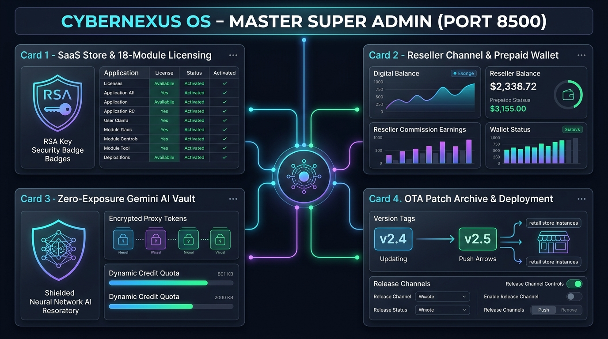
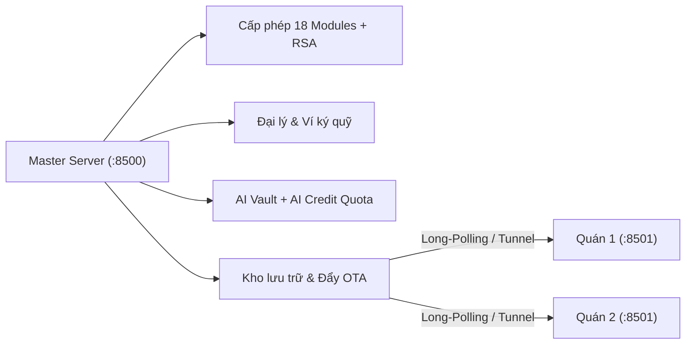
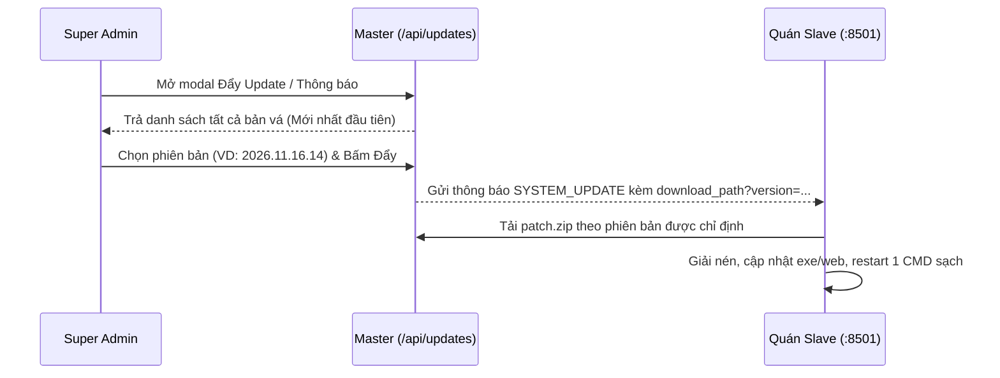

# HƯỚNG DẪN SỬ DỤNG HỆ THỐNG MASTER (SUPER ADMIN CLOUD SAAS)

> **Phiên bản:** `v1.0.0` | **Ứng dụng:** `master/cybernexus_master.exe` | **Cổng mặc định:** `8500`  
> **Đường dẫn quản trị:** `http://localhost:8500/super_admin.html` (hoặc `http://<IP_MASTER>:8500/super_admin.html`)

---

## 1. Tổng Quan Kiến Trúc & Chức Năng Master

**CyberNexus Master Platform** là máy chủ trung tâm điều hành chuỗi cửa hàng F&B, cấp phép bản quyền RSA (`CBNX-XXXX-XXXX-XXXX-XXXX`), quản lý kênh đại lý, bảo mật API Gemini AI (Zero-Exposure AI Vault), cấp hạn mức AI Credit và phát hành cập nhật OTA từ xa.

---

## 2. Khởi Động & Đăng Nhập Super Admin

1. **Khởi động máy chủ Master:**
   - Mở thư mục `master/` và chạy `cybernexus_master.exe` (giữ cửa sổ terminal chạy nền).
   - Hệ thống tự động khởi tạo/cập nhật CSDL tại `master/database/cybernexus_master.db` và lắng nghe tại cổng `8500`.
2. **Truy cập giao diện Super Admin:**
   - Mở trình duyệt vào `http://localhost:8500/super_admin.html`.
   - Đăng nhập bằng tài khoản quản trị Super Admin được cấp.

---

## 3. Quản Lý Cửa Hàng, Gói Cước & Bản Quyền (18 Modules)

### 3.1. Thêm cửa hàng mới & Cấp License Key
1. Trên màn hình chính **Quản Lý Cửa Hàng**, bấm nút **`+ Thêm Cửa Hàng Mới`**.
2. Điền đầy đủ:
   - **Mã quán** (VD: `GP001`), **Tên quán**, **Chủ quán & SĐT**.
   - **Gói dịch vụ** & **Thời hạn hợp đồng** (Tháng / Năm / Trọn đời).
3. Hệ thống tự động sinh mã bản quyền chuẩn **`CBNX-XXXX-XXXX-XXXX-XXXX`** kèm chữ ký số RSA.
4. Bấm biểu tượng **Chìa khóa** trên dòng cửa hàng để sao chép License Key gửi cho chủ quán.

### 3.2. Phân quyền bật/tắt chi tiết từng Module (18 Modules)
1. Bấm biểu tượng **Quản lý Gói / Module** (`17/18` hoặc nút khóa/mở module) tại cột **Thao tác** của quán.
2. Hệ thống hỗ trợ 18 module độc lập, trong đó tách bạch hoàn toàn:
   - **Truyền thông & Quảng cáo (`advertising_promotions`)**: Trình chiếu ảnh/video trên menu QR khách hàng.
   - **Khuyến mãi & Voucher (`promo_voucher_engine`)**: Tạo mã giảm giá, chương trình khuyến mãi tự động.
   - Các phân hệ khác: `pos_core`, `kitchen_kds`, `waiter_mobile`, `customer_qr`, `online_orders`, `finance_reports`, `audit_shifts`, `inventory_recipes`, `staff_shifts`, `staff_kpi`, `media_jukebox`, `network_qos`, `card_payment`, `ai_assistant`, v.v.
3. Có thể **Chặn (`BLOCK`)** hoặc **Mở lại** từng module theo thời gian thực; quán sẽ tự động đồng bộ quyền trong vòng tối đa 5 phút (hoặc ngay khi kiểm tra bản quyền).

### 3.3. Giám sát kết nối quán (LAN / WAN / Google Maps)
- Cột **Mạng & Vị Trí** hiển thị IP LAN, IP WAN, tên nhà mạng và vị trí định vị của quán.
- Bấm nút **`Kiểm tra kết nối`** trên thanh công cụ để quét trạng thái `Online / Offline` và độ trễ (`ms`) của toàn bộ hệ thống.

---

## 4. Quản Lý Kênh Đại Lý Phân Phối & Ví Ký Quỹ

1. Chọn mục **`Đại Lý Phân Phối`** trên thanh điều hướng bên trái.
2. **Tạo Đại lý mới:** Bấm **`+ Thêm Đại Lý`**, nhập mã đại lý (`DL-001`), tên công ty và chọn hạng đối tác:
   - 🥉 **Đồng (Bronze):** Chiết khấu 15%
   - 🥈 **Bạc (Silver):** Chiết khấu 25%
   - 🥇 **Vàng (Gold):** Chiết khấu 40%
   - 💎 **Kim Cương (Diamond):** Chiết khấu 55%
3. **Nạp tiền vào Ví ký quỹ:** Bấm **`Nạp Ví`** trên dòng đại lý, chọn mệnh giá nhanh (`5M`, `15M`, `30M`, `60M`) hoặc nhập số tiền thực tế. Mọi giao dịch được ghi vào sổ cái `saas_reseller_wallet_logs`.
4. **Cấp Key qua Đại lý:** Bấm **`Cấp Key`**, hệ thống tự động tính giá sau chiết khấu, trừ ví ký quỹ của đại lý và sinh License Key cho quán mới.

---

## 5. Bảo Mật AI Vault & Cấp Hạn Mức AI Credit Cho Từng Quán

> **Nguyên tắc Zero-Exposure:** API Key Google Gemini **chỉ lưu duy nhất trên Master** (`master_settings`), tuyệt đối không gửi xuống máy quán.

1. **Cấu hình Gemini API Key tổng:**
   - Vào **Cài Đặt SaaS & VietQR** → mục **Master AI Vault**.
   - Nhập `Gemini API Key` và bấm **Lưu**. Hệ thống tự động kiểm tra kết nối Gemini, lưu an toàn và **xóa trắng/ẩn ô nhập** ngay sau khi lưu.
2. **Cấp Quota AI Credit cho từng quán:**
   - Tại danh sách cửa hàng, bấm nút cấu hình **AI Quota** của quán.
   - Thiết lập **Hạn mức hàng tháng (`ai_monthly_quota`)**: nhập số dương (mặc định `50` credit/tháng), nhập `-1` cho không giới hạn, hoặc `0` để tắt AI.
   - Có thể nạp thêm **Credit thưởng (`ai_bonus_credits`)** bất cứ lúc nào.
3. **Quy đổi chi phí thao tác AI (chỉ trừ khi gọi thành công):**
   - Quét OCR hóa đơn nhập kho: **`1` credit**
   - Tạo ảnh món ăn bằng AI: **`2` credit**
   - Tạo slide quảng cáo / banner bằng AI: **`3` credit**

---

## 6. Quản Lý Kho Bản Vá & Đẩy Cập Nhật OTA Xuống Quán

### 6.1. Đẩy bản cập nhật OTA (Cho phép chọn bất kỳ phiên bản nào)
1. Trên màn hình chính, bấm **`Đẩy Update / Thông báo`** (hoặc bấm nút đẩy riêng trên từng dòng quán).
2. Chọn chế độ **`Đẩy Bản Vá OTA`** (hoặc **`Chỉ Gửi Thông Báo`**).
3. Tại ô **Chọn Phiên Bản Bản Vá**, hệ thống liệt kê **đầy đủ tất cả các phiên bản** đã phát hành trong `master/updates/archive/` (mặc định chọn sẵn phiên bản **`[Mới nhất]`**).
4. Nhập tiêu đề/ghi chú (hoặc giữ mặc định theo `manifest.json`) và bấm **`Gửi Xuống Quán`**.

### 6.2. Quản lý Kho Lưu Trữ Bản Vá (`list_patches`)
1. Vào **Cài Đặt SaaS & VietQR** → **Kho Lưu Trữ & Quản Lý Tất Cả Bản Vá OTA**.
2. Tại đây Super Admin có thể:
   - **Xem toàn bộ lịch sử phiên bản** (`2026.11.16.1` → `2026.11.16.14`), dung lượng file và ghi chú phát hành.
   - **Kích hoạt / Rollback (`Kích hoạt`):** Đặt bất kỳ bản vá cũ nào làm `patch_latest.zip` mặc định nếu cần hạ phiên bản khẩn cấp.
   - **Đẩy nhanh (`Đẩy bản này`):** Mở nhanh modal đẩy OTA với phiên bản đó được chọn sẵn.
   - **Xóa (`Xóa`):** Dọn dẹp các bản vá cũ không còn sử dụng.

---

## 7. Khắc Phục Sự Cố Thường Gặp (Master)

| Tình huống | Nguyên nhân | Cách xử lý |
|---|---|---|
| Quán báo `Offline` dù đang mở | Chưa bật kênh WAN hoặc đổi IP Master | Kiểm tra `server_ip` / URL Master trong cài đặt quán khớp với IP máy Master (`port 8500`). |
| Quán gọi AI báo lỗi HTTP `402` | Hết AI Credit tháng | Mở quản lý cửa hàng trên Super Admin → nạp thêm `ai_bonus_credits` hoặc tăng `ai_monthly_quota`. |
| Đẩy OTA xong giao diện chưa đổi | Trình duyệt giữ cache cũ | Nhắc quán bấm `Ctrl + F5` (hoặc vuốt tải lại trên điện thoại). |
