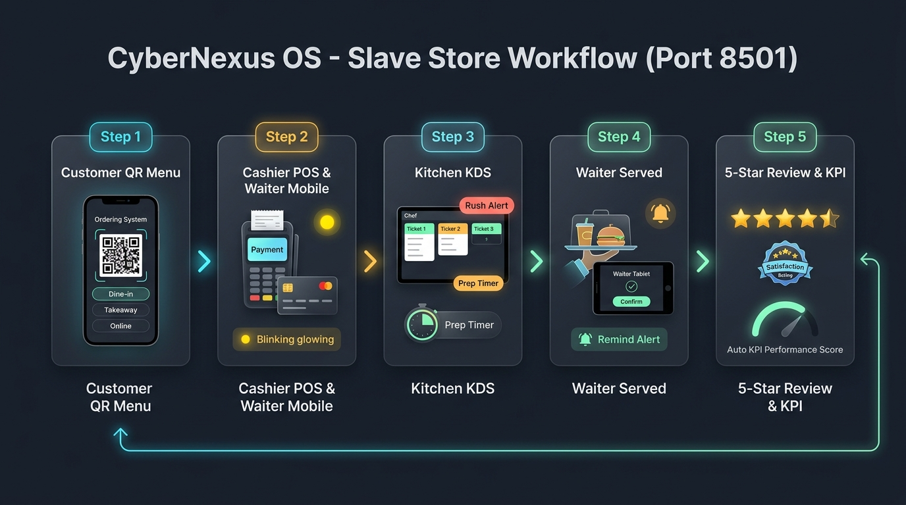
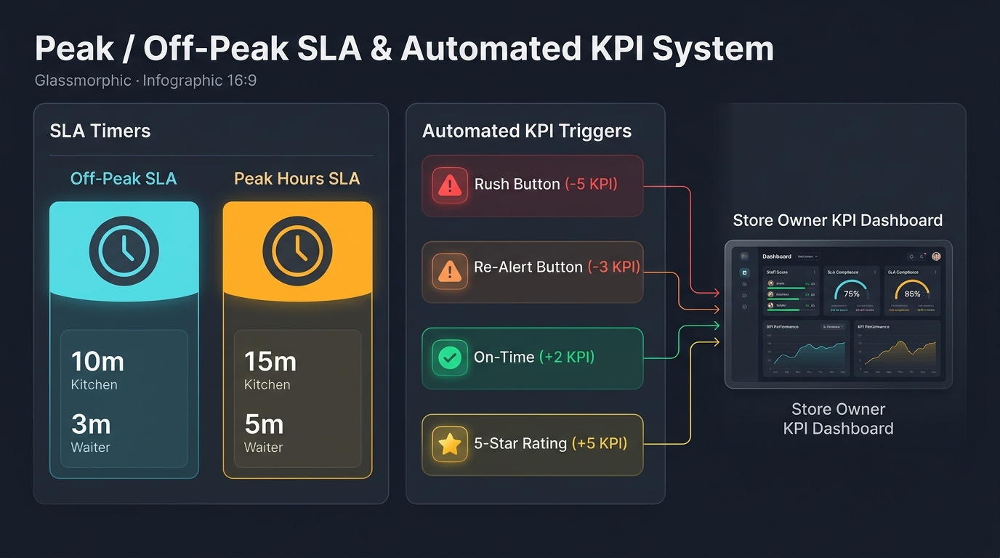

# HƯỚNG DẪN SỬ DỤNG HỆ THỐNG SLAVE (CỬA HÀNG F&B)

> **Phiên bản:** `v1.0.0` (`2026.11.16.14`) | **Ứng dụng:** `slave/cybernexus_slave.exe` | **Cổng mặc định:** `8501`

---

## 1. Tổng Quan Các Màn Hình Tại Quán

Sau khi chạy `RUN_SLAVE.bat` (hoặc `cybernexus_slave.exe`) và mở tường lửa LAN (`Mo_Tuong_Lua_LAN.bat` nếu cần), toàn bộ thiết bị trong mạng Wi-Fi/LAN của quán truy cập qua địa chỉ IP LAN của máy chủ (VD: `http://10.0.126.161:8501`):

| Vai trò | Đường dẫn truy cập | Thiết bị khuyên dùng |
|---|---|---|
| **Chủ quán (Admin)** | `/admin.html` | Máy tính / Laptop / Tablet |
| **Thu ngân (POS)** | `/index.html` | Máy POS cảm ứng / PC quầy |
| **Phục vụ (Order)** | `/order.html` | Điện thoại di động / Tablet |
| **Bếp & Pha chế (KDS)** | `/kitchen.html` | Màn hình / Tablet đặt tại quầy Bếp |
| **Khách hàng quét QR** | `/` hoặc `/customer.html` | Điện thoại khách hàng |
| **Đơn Online / Giao đi** | `/online_orders.html` | PC quầy Thu ngân / Phục vụ |



```mermaid
flowchart TD
    C["Khách quét QR (customer.html)"] -->|Tại bàn| W["Phục vụ (order.html) duyệt & Chuyển Bếp"]
    C -->|Mang về / Online| P["Thu ngân (index.html) xác nhận TT -> Chuyển Bếp"]
    W -->|Chấm vàng nhấp nháy| K["Bếp KDS (kitchen.html)"]
    P -->|Chấm vàng nhấp nháy| K
    W -.->|Quá SLA Bếp -> Nút HỐI (-5 KPI)| K
    K -->|Xong món| W
    K -.->|Quá SLA Phục vụ -> Báo Lại (-3 KPI)| W
    W -->|Đã bưng ra bàn| R["Khách đánh giá 1-5 Sao -> Tự động tính KPI"]
```

---

## 2. Hướng Dẫn Dành Cho Chủ Quán (`/admin.html`)

### 2.1. Theo dõi Phiên bản & Cập nhật OTA
- Trên góc phải thanh Header luôn hiển thị huy hiệu phiên bản hiện tại (VD: `v2026.11.16.14`).
- Khi Super Admin đẩy bản vá OTA, bấm **`Kiểm tra / Cập nhật ngay`** để hệ thống tự động tải bản vá, cập nhật và khởi động lại sạch sẽ trong **1 cửa sổ CMD duy nhất**.

### 2.2. Thiết lập Mạng LAN & Mã QR Bàn
1. Vào **Hệ Thống & Quán → Cài Đặt Quán**.
2. Kiểm tra mục **Thiết Lập Máy Chủ & IP LAN**: chọn card mạng vật lý của quán (VD: `10.0.126.161`) và bấm **Lưu**.
3. Vào **Thực Đơn & Kho → Bàn & Khu Vực (QR)** để thêm bàn (`TQ1..TQ8`, `MV1..MV5`) và in **Standee QR** hàng loạt cho từng bàn.

### 2.3. Thiết lập Mốc Thời Gian Cao Điểm / Thấp Điểm (SLA) & Quy Tắc KPI


1. Vào **Nhân Sự & Bếp → KPI & Thưởng**.
2. Bấm nút **`Thiết lập SLA & Điểm KPI`** để tùy chỉnh:
   - **Mốc mặc định (Thấp điểm):** Bếp làm **`10` phút** | Phục vụ bưng ra **`3` phút**.
   - **Khung giờ Cao điểm tùy chỉnh:** Hệ thống cài sẵn 3 mốc mẫu (`07:00–09:30` Sáng, `11:00–13:30` Trưa, `18:00–21:00` Tối với SLA Bếp `15p`, Phục vụ `5p`). Chủ quán có thể thêm, sửa, bật/tắt hoặc xóa mốc giờ bất kỳ.
   - **Bảng điểm KPI & Đánh giá Sao (mặc định, có thể sửa):**
     - Điểm nền đầu kỳ: **`100`** điểm.
     - Bếp xong đúng hạn: **`+2`** | Bếp bị hối: **`-5`** / lần.
     - Phục vụ bưng đúng hạn: **`+2`** | Phục vụ bị Bếp bấm "Báo lại": **`-3`** / lần.
     - Khách đánh giá: **5⭐ (`+5`)**, **4⭐ (`+2`)**, **3⭐ (`0`)**, **2⭐ (`-3`)**, **1⭐ (`-5`)**.
3. Bên dưới bảng KPI tổng hợp có **Nhật ký cộng/trừ KPI chi tiết** và **Danh sách đánh giá Sao của khách hàng** theo từng tháng.

### 2.4. Tài chính P&L, Kiểm toán Ca & Khuyến mãi
- **Báo Cáo Tài Chính:** Theo dõi P&L real-time từ ngày `01` đến hiện tại, so sánh 3 tháng, quản lý công nợ và kiểm toán chống thất thoát (`audit_logs`, `pos_shifts`).
- **Khuyến Mãi & Voucher:** Tạo mã giảm giá theo `%` hoặc số tiền cố định, giới hạn đơn tối thiểu và khung giờ áp dụng.
- **Trợ lý AI:** Tạo ảnh món ăn, slide quảng cáo và quét OCR hóa đơn nhập kho (sử dụng AI Credit do Master cấp).

---

## 3. Hướng Dẫn Dành Cho Phục Vụ (`/order.html` - Mobile)

1. **Kích hoạt âm thanh:** Chạm thanh vàng **`Kích hoạt chuông & rung`** ở đầu trang ngay khi mở ca để Safari/Chrome phát chuông khi có món mới.
2. **Nhận thông báo đơn QR mới:**
   - Khi khách quét QR đặt món tại bàn, điện thoại phục vụ **phát chuông**, ô bàn nhấp nháy đỏ kèm nút **`CHUYỂN BẾP`**, đồng thời hiện thẻ trong **Trung tâm thông báo**.
   - Phục vụ kiểm tra lại món với khách rồi bấm **`CHUYỂN BẾP`** (hoặc bấm vào bàn để thêm món rồi bấm **`Gửi Bếp`**).
3. **Theo dõi món đang làm (Chấm vàng nhấp nháy & Nút "Hối"):**
   - Sau khi chuyển bếp, thẻ bàn hiển thị **chấm tròn vàng nhấp nháy** (kể cả khi bàn đã `Đã TT`).
   - Nếu quá thời gian phục vụ của bếp theo khung giờ hiện tại (mặc định 10p thấp điểm / 15p cao điểm), thẻ bàn tự động hiện số phút chờ và nút **`Hối`**. Bấm **`Hối`** để phát chuông khẩn sang màn hình Bếp.
4. **Bưng món ra bàn:**
   - Khi Bếp bấm xong món, máy Phục vụ đổ chuông và thẻ bàn chuyển vàng rực với nút **`ĐÃ BƯNG RA`**. Bấm nút này ngay khi mang món tới bàn cho khách để ghi nhận đúng hạn KPI.
5. **Xử lý báo hết món / xin hủy món:** Nếu Bếp báo hết hoặc từ chối hủy, thông báo hiện ở đầu trang; bấm **`Đã báo khách`** sau khi xử lý xong.

---

## 4. Hướng Dẫn Dành Cho Thu Ngân (`/index.html`)

1. **Nhận thông báo & Xử lý đơn QR / Online:**
   - Khi có đơn QR mới (Tại bàn, Mang về, Online), thanh cảnh báo đầu trang phát chuông + hiện thông báo nổi với nút **`Mở bàn`**, **`Chuyển Bếp`** hoặc chuyển sang **`online_orders.html`**.
   - **Cổng thanh toán → Chuyển Bếp:** Đơn *Mang về / Online* bắt buộc xác nhận đã nhận tiền (tự động qua Webhook ngân hàng hoặc Thu ngân bấm xác nhận / duyệt COD) trước khi hệ thống cho phép chuyển xuống Bếp.
2. **Theo dõi Bếp & Hối món:**
   - Lưới bàn Thu ngân (cả giao diện Desktop và Mobile) đều hiển thị **chấm vàng nhấp nháy** cho bàn đang chế biến và tự động nổi nút **`Hối`** khi quá SLA bếp.
3. **Thanh toán, In Bill & Quyết toán chênh lệch:**
   - Hỗ trợ Tiền mặt, Chuyển khoản VietQR động, Quẹt thẻ, áp dụng Voucher khuyến mãi.
   - Nếu đơn đã thanh toán phát sinh thêm món hoặc hủy/hết món, hệ thống tự động tính phần **Thu thêm (`extra_due`)** hoặc **Hoàn tiền (`refund_due`)** để thu ngân xử lý minh bạch.
4. **Giao ca & Sổ quỹ (`Giao Ca / Quỹ`):** Mở ca đầu ngày, lập phiếu thu/chi tại quầy và kết ca kiểm đếm tiền mặt cuối ngày.

---

## 5. Hướng Dẫn Dành Cho Bếp & Pha Chế (`/kitchen.html`)

1. **Bật âm thanh:** Kiểm tra nút loa trên header ở trạng thái **Bật** để nghe chuông khi có đơn mới hoặc khi bị hối.
2. **Nhận phiếu chế biến & Xử lý đơn bị Hối:**
   - Phiếu mới hiển thị danh sách món, số lượng, topping và ghi chú món.
   - Nếu Phục vụ/Thu ngân bấm **`Hối`**, Bếp phát chuông đôi khẩn cấp, phiếu đổi viền đỏ và gắn nhãn **`🔥 HỐI MÓN (xN)`**.
3. **Báo xong món & Nhắc phục vụ (`Báo Lại`):**
   - Chế biến xong bấm **`Xong Món (Báo Phục Vụ)`**.
   - Nếu quá SLA bưng món mà phục vụ chưa ra lấy, nút **`Báo Lại`** chuyển màu cảnh báo **`Báo Lại (Nhắc PV)`**; bấm vào để rung chuông nhắc lại Phục vụ (hệ thống tự ghi nhận KPI).
4. **Báo Hết Món (86) & Xin Hủy:**
   - Bấm **`Hết`** trên từng món để khóa món tức thời trên tất cả màn hình (Phục vụ, Thu ngân, Khách QR).
   - Bấm biểu tượng **Thùng rác** trên phiếu nếu cần gửi yêu cầu hủy cả đơn lên Thu ngân duyệt.

---

## 6. Trải Nghiệm Khách Hàng Quét QR (`/customer.html`)

1. **Chọn 1 trong 3 hình thức đặt món:**
   - **Ngồi tại bàn:** Chọn đúng bàn trống (hoặc tự điền bàn nếu quét QR gắn sẵn `?table=TQ1`).
   - **Mang về (tại quán):** Hệ thống tự gán số Mang Về (`MV1..MV5`).
   - **Giao hàng Online:** Nhập tên, SĐT, địa chỉ giao hàng.
2. **Thanh toán & Theo dõi trạng thái Real-time:**
   - Tạo mã VietQR động đúng số tiền (sau khi áp dụng Voucher nếu có) → bấm **`Tôi đã chuyển khoản xong`** để báo Thu ngân/Webhook xác nhận.
   - Theo dõi tiến độ món theo thời gian thực (*Đang chế biến → Đã xong → Đã bưng ra / Hoàn tất*).
3. **Đánh giá 1–5 Sao:** Sau khi đơn hoàn thành, khách chọn số sao và nhập góp ý trực tiếp trên màn hình.
